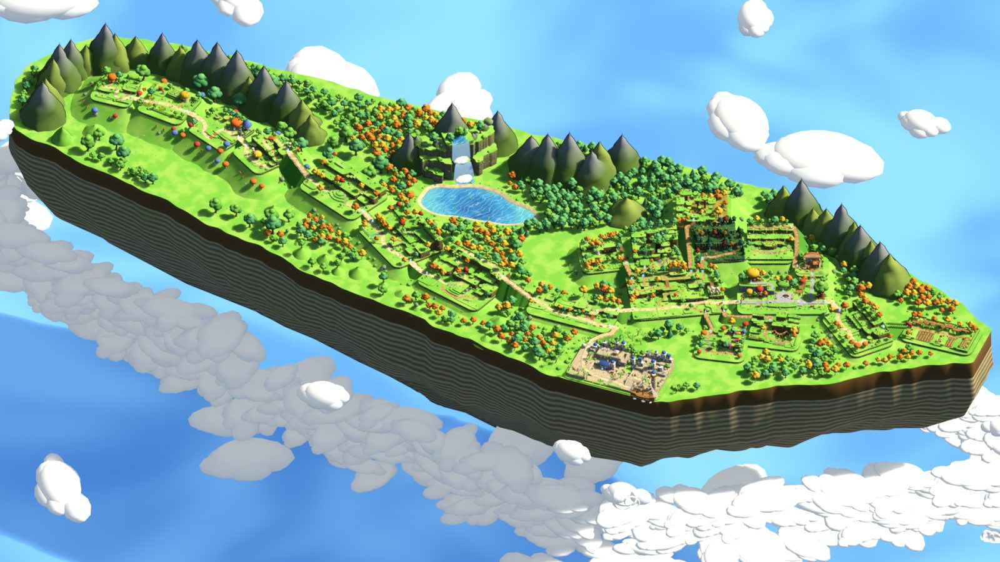
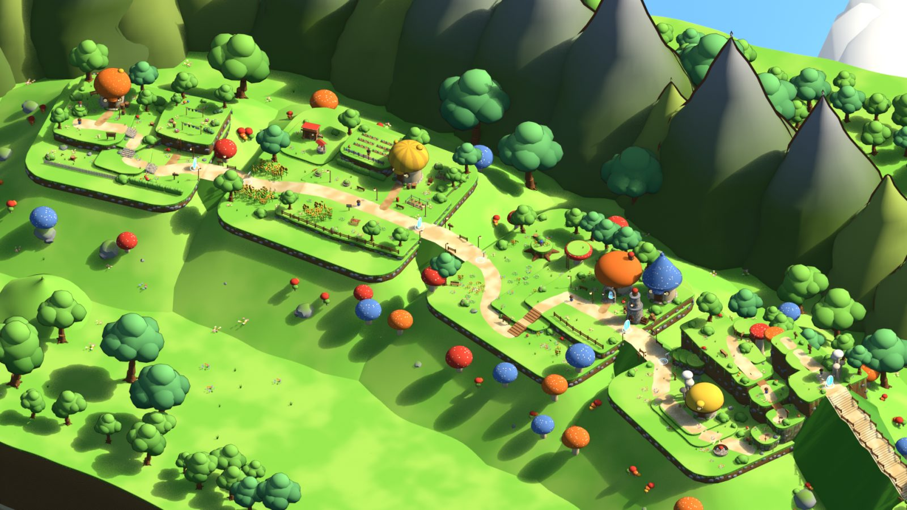
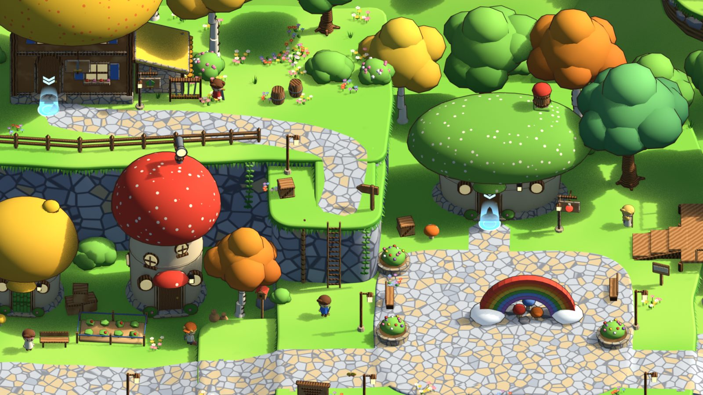
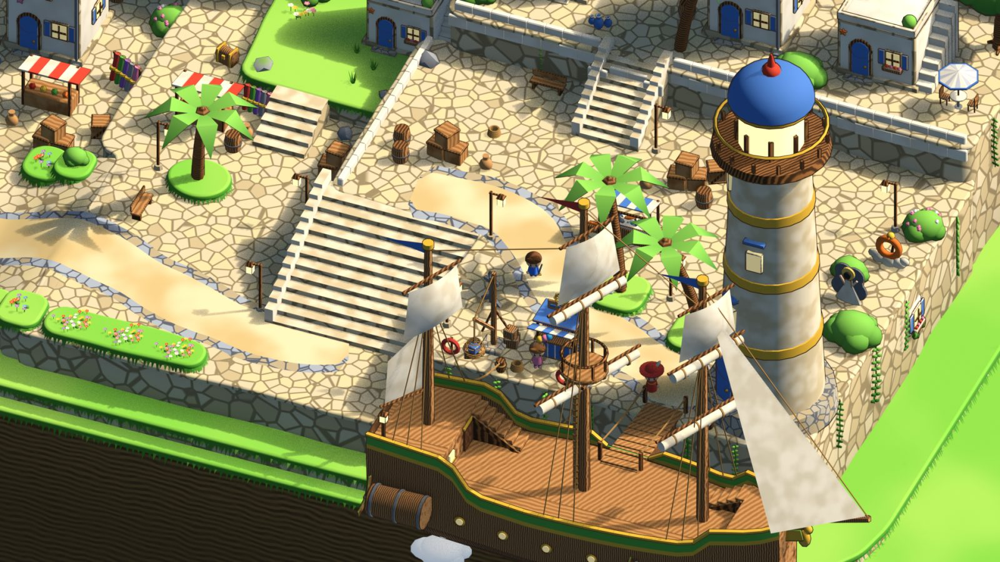
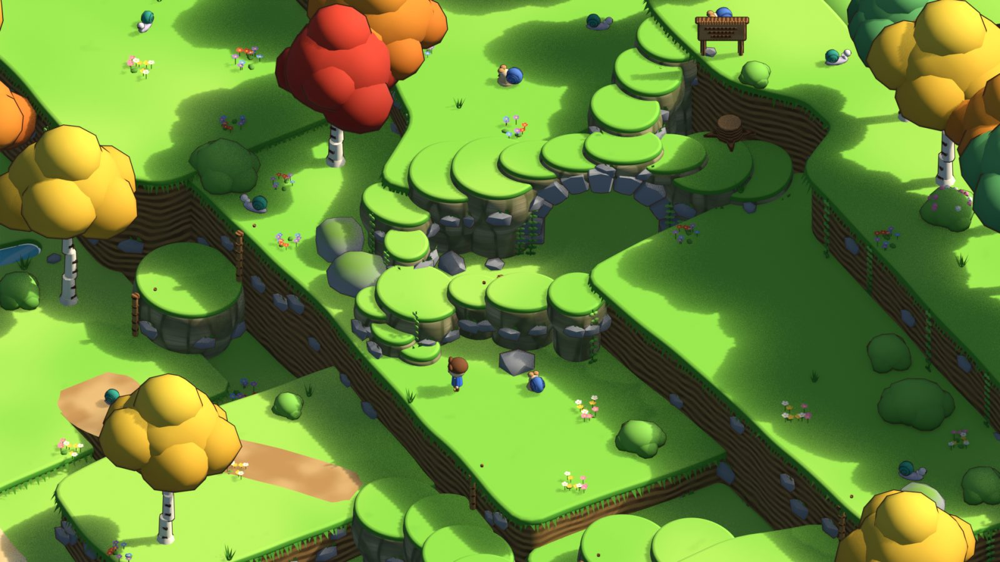
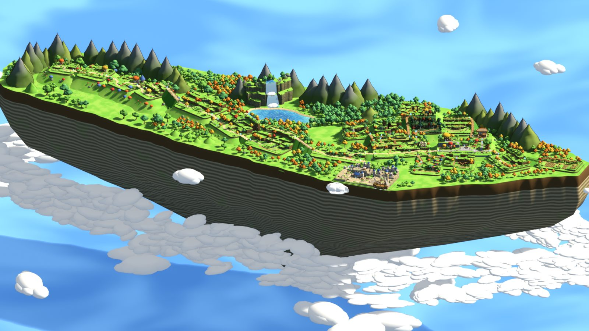

# MisoStory: Maple Island

> What would classic Maple Island have felt like if MapleStory had originally been an isometric 3D game?

**Iteration One** builds **all 25 classic Maple Island maps** (GMS v0.08–v0.22 era) as one geographically
coherent, floating 3D island in **Blender 5.2**. It uses an orthographic isometric camera and a stylized,
hand-crafted, MapleStory-inspired look. Python generates everything deterministically: the `.blend` is a build
artifact, and the scripts and data are the source. The `.blend` and renders are not committed. Build them with one
command, or download them from the [latest release](https://github.com/itechify/maplestory-isometric/releases/latest).
**Iteration Two** turns that island into a playable game (below).



## Play it (Iteration Two)

Iteration Two turns the island into a playable **Godot 4.7** game (`game/`), using gameplay data from
[MeowDB MS Classic](https://meowdb.com/msclassic) (see [`docs/canonical/README.md`](docs/canonical/README.md)).
Brief: [`docs/ITERATION_TWO_BRIEF.md`](docs/ITERATION_TWO_BRIEF.md). Architecture: [`docs/runtime/ARCHITECTURE.md`](docs/runtime/ARCHITECTURE.md).
How-to (build, test, validate, debug): [`docs/runtime/HOWTO.md`](docs/runtime/HOWTO.md). Playthrough results:
[`docs/runtime/PLAYTHROUGH_REPORT.md`](docs/runtime/PLAYTHROUGH_REPORT.md).

```bash
bash scripts/build_runtime.sh   # once (~6 min): builds MapleIsland.blend, exports the world, imports it into Godot
bash scripts/play.sh            # launches the game (Godot 4.7.2 is downloaded on first use)
bash scripts/test.sh            # 1100+ headless tests;  bash scripts/validate_data.sh checks the canonical data
```

| Keys | Action |
|---|---|
| W A S D | move (8 directions, relative to the camera) |
| Space / Alt | jump |
| J / Ctrl / left click | attack |
| F | talk to the NPC in front of you |
| Up arrow | enter a portal, grab a ladder or rope (W/S or Up/Down to climb) |
| Z | pick up drops |
| I / E / C / Q | inventory, equipment, character stats (spend AP), quest log |
| 1 – 8 | quickslots (bind consumables from the inventory) |
| Esc | close the newest window, else the pause menu (save, load, controls, quit) |
| ` (backtick) / F3 | developer console (`help`, `warp <map>`, `give <item> [qty]`, `exp <n>`, `level <n>`, `mesos <n>`) / debug overlay |

## Quick start

| What | Command (Git Bash, Windows) |
|---|---|
| Get the built island without building | Download `MapleIsland.blend` and `renders-final.zip` from the [latest release](https://github.com/itechify/maplestory-isometric/releases/latest), or `gh release download --repo itechify/maplestory-isometric` |
| Build the whole island → `MapleIsland.blend` | `"/c/Program Files/Blender Foundation/Blender 5.2/blender.exe" -b --factory-startup --python scripts/build_island.py` |
| Build + render every camera | `... --python scripts/build_island.py -- --render final` |
| Render cameras from an existing .blend | `blender -b MapleIsland.blend --python scripts/render_review.py -- <tag> [camera filters] [--debug]` |
| Build/render one map while authoring | `blender -b --factory-startup --python scripts/build_map.py -- <mapId> --debug` |
| Validate the island | `blender -b MapleIsland.blend --python scripts/validate.py` → `docs/VALIDATION.md` |
| Export the topology manifest | `"<blender>/5.2/python/bin/python.exe" scripts/export_manifest.py` |
| Asset gallery | `blender -b --factory-startup --python scripts/asset_gallery.py -- out.png Asset_A Asset_B ...` |

**Blender version:** 5.2.2 LTS, with EEVEE, Standard view transform and soft principled shading. A full build
takes well under a minute; rendering all cameras takes a few minutes on an RTX 4070.

## Viewing the island in Blender

Open `MapleIsland.blend`. It opens looking through `CAM_Island_Overview` in material preview (press Home over the
viewport to fit the camera frame if your window size differs). Every camera lives in
`CAMERAS`; set any of them active (Ctrl+Numpad 0 on a selected camera) to look through it:

- `CAM_Island_Overview`, `CAM_Island_Hero` (low angle showing the floating underside), `CAM_Island_WorldMapStyle`
  (a steeper view that reads like the classic world map), and `CAM_Island_Overview_Close`.
- `CAM_Region_*`: Maple Road, the Mushroom Town area, the Snail Hunting Grounds, Southperry and the Split Road,
  Rainbow Street, the Amherst area, and the west Amherst forests.
- `CAM_<Map>_Overview` frames a whole map; `CAM_<Map>_Gameplay` is a closer view at gameplay scale.

The `DEBUG` collection is hidden in the viewport and excluded from renders by default. Turn it on (the eye icon
in the outliner) to see traversal routes (magenta), spawn rings, NPC beacons and map labels.

## World organization

```
MAPLE_ISLAND
├─ MAPS/<Slug_ID>/{_Terrain,_Architecture,_Vegetation,_Props}   one collection per classic map (IDs disambiguate the two "Mushroom Town" maps)
├─ WORLD/{World_IslandBody, World_Plinths, World_Trails, World_Scenery, World_Forest, World_SkyAndSea}
├─ ENVIRONMENT_ASSETS/{Trees, Foliage, Rocks, Terrain, Architecture, Props, Markers}   excluded asset library; instanced everywhere
├─ CHARACTER_PROXIES/{_CharacterLibrary, Player, NPCs_<Slug>}
├─ MONSTER_PROXIES/{_MonsterLibrary, Mobs_<Slug>}
├─ PORTALS/Portals_<Slug>      portal objects carry map_id / portal_name / to_map / to_portal
├─ CAMERAS/{Cams_<Slug>, Cams_Island}
├─ LIGHTING                    one sun + sky for the whole island
└─ DEBUG/Debug_<Slug>          routes, spawn rings, NPC beacons, labels
```

- **Geography** follows the game's own classic world map (WorldMap0). Maple Island is a floating plateau.
  Mushroom Town sits in the north-west pocket, and the valley road runs south-east through the Snail Hunting
  Grounds to the fork at A Split Road. Southperry, with its lighthouse and moored ship, is on the south rim.
  Rainbow Street runs east through the Field West of Amherst, with its forest and garden side maps, to Amherst
  and the far fields. A waterfall-fed lake and conical peaks fill the interior. The layout is authored in the
  world-map frame and rotated −45°, so the isometric overview reads like the classic map.
- **Topology** is authoritative in `docs/topology.json` (raw GMS v8 WZ portal data) and is mirrored by
  `src/misostory/layout.py` (`LINKS`, `DOOR_LINKS`). Neighbouring maps are joined by physical trails between
  their edge portals. Interiors (20001, 60001, 1010001, 1010003) are cutaway rooms on a remote "interior stage"
  reached by door portals.

## Asset generation approach

- `src/misostory/geo.py`: bmesh and curve primitives. The signature MapleStory **terrace** is a rounded grass cap
  overhanging an earthen or stone body, with a jagged grass fringe and stones embedded in the cliff. There are
  also ramps, stairs, paths, water and foam.
- `src/misostory/materials.py`: procedural "painted" materials (two-tone noise, top/side tinting, gradients,
  cobble, strata, spots, streaks). They all feed one shared shading group, so the whole island can be restyled
  in one place. Inked outlines are inverted-hull solidify shells.
- `src/misostory/kit/`: a **reusable asset library** (about 120 assets) built once and instanced everywhere.
  Trees, bushes, flowers and mushrooms; rocks and peaks; Maple Island mushroom houses, cottages, shops, the
  lighthouse, the ship and docks; fences, signs, ladders and props; portal, spawn and NPC markers; the chibi
  player and NPC proxies; and the five classic monsters modeled from the v8 sprites. See `docs/ASSET_CATALOG.md`.
- `src/misostory/mapkit.py`: `MapCtx`, the authoring API every map uses. It works in map-local coordinates,
  grounds props by raycast and fails loudly when there is no ground. It also handles portals with topology
  lookup, NPCs from `npcs.py`, representative spawns, traversal routes and per-map cameras.
- `src/misostory/maps/m<ID>_<Name>.py`: one module per classic map, translating that map's research brief
  (tiers, ladders, landmarks, NPCs, monsters) into 3D.
- `src/misostory/world.py`: the island body and floating underside, map plinths, trails, the lake and
  waterfall, occlusion-aware peaks and forest, clouds and the sea far below.
- `src/misostory/traversal.py`: walks every declared route over the real geometry, checking steps, slopes,
  ladders, gaps and portal grounding.

Authoring rules and the API reference are in `docs/AUTHORING.md`.

## Working on this repo

The `.blend` and renders are build outputs: they stay out of git and are published as release assets at milestones.
See [CONTRIBUTING.md](CONTRIBUTING.md) for what to commit, the build and validate loop, how to refresh the README
images, and how to cut a release.

## Research and documentation

| Document | Contents |
|---|---|
| `docs/MAP_INVENTORY.md` | Researched inventory of all 25 classic maps: IDs, connections, NPCs, monsters, landmarks, discrepancies and decisions |
| `docs/topology.json`, `docs/topology.mmd` | Authoritative topology (portal → destination) and a Mermaid graph |
| `docs/MAPLE_ISLAND_MANIFEST.md`, `docs/manifest.json` | Built-world manifest: every map, its placement, exits and destinations, built NPCs, monsters and routes |
| `docs/research/maps/<id>_*.md` | Per-map structural analysis and 3D translation briefs |
| `docs/research/*.md` | Wiki and landmark notes, geography (classic world map), entities (NPCs and mobs) |
| `docs/ITERATION_LOG.md` | Major problems found and corrected |
| `docs/DEFERRED.md` | What is deliberately left for Iteration Two |
| `docs/VALIDATION.md` | Latest validation results |
| `docs/review/` | Island reviews 1 and 2 (raw critiques and triage) and the final acceptance check |
| `docs/images/` | Small README images (refresh with `scripts/readme_images.py`) |
| `renders/final/` | Final validation renders for every camera, plus debug variants. Generated and not in git: run `scripts/render_all.sh final 3 --debug`, or get `renders-final.zip` from a release |
| `CONTRIBUTING.md` | What goes in git, the everyday build/validate workflow, README images and releases |

## Representative renders

| | |
|---|---|
|  Mushroom Town |  Amherst |
|  Southperry |  Snail Hunting Ground II |



Full-resolution renders of every camera are generated into `renders/final/`, or come in `renders-final.zip` on each
release:

| Subject | Files in `renders/final/` |
|---|---|
| Full island | `Island_Overview.png`, `Island_Overview_Close.png`, `Island_Hero.png`, `Island_WorldMapStyle.png` |
| Mushroom Town | `Region_MushroomTownArea.png`, `MushroomTown_10000_Gameplay.png`, `MushroomTown_20000_Gameplay.png`, `WestEntranceMushroomTown_0_Gameplay.png` |
| Amherst | `Region_AmherstArea.png`, `Amherst_1010000_Gameplay.png`, `Amherst_1010000_Overview.png` |
| Southperry | `Region_SouthperryAndSplitRoad.png`, `Southperry_60000_Gameplay.png`, `Southperry_60000_Overview.png` |
| Snail Hunting Grounds | `Region_SnailHuntingGrounds.png`, `SnailHuntingGround1_40000_Gameplay.png`, `SnailHuntingGround2_40001_Gameplay.png`, `SnailHuntingGround3_40002_Gameplay.png` |
| Western Amherst hunting areas | `Region_WestAmherstForests.png`, `DangerousForest_1000002_Gameplay.png`, `HuntingGroundMidForest1_1000005_Gameplay.png`, `HuntingGroundMidForest2_1000006_Gameplay.png`, `InASmallForest_1000001_Gameplay.png` |

Every map has `<Slug>_Overview.png` and `<Slug>_Gameplay.png`. In the final validation every check passes: hierarchy,
naming, hidden objects, materials, instances, triangle budgets, portal topology, floating props, props near routes,
traversal, route connectivity, player in the gameplay frame, the portal-to-portal walk of all 20 inter-map trails, and
swallowed exceptions.

**Proprietary reference material:** `docs/research/ref_renders`, `ref_sprites`, `ref_web` and `raw` hold Nexon
game data and art, fetched only as reference. None of it is loaded into the `.blend` or used as a texture; all
geometry and materials are original. Do not redistribute those folders.

## Known limitations

Full list: `docs/DEFERRED.md`. Current validator state: `docs/VALIDATION.md`.

- **Placeholder art.** Characters and monsters are Iteration One's static chibi proxies (no rigs or animation
  beyond procedural bob and lunge); the Tutorial Jr. Sentinel is a grey placeholder. There is no audio.
- **Iteration Two scope.** One Beginner on Maple Island: no job advancement, skills window, sitting, minimap, the ship
  to Victoria Island, or multiplayer. All 20 Maple Island quests run through the generic engine, but only 1002, 1006
  and 1007 → 1008 are verified by real-game playthroughs. Drop chances and meso amounts are labelled placeholders
  (MeowDB publishes none). Details: [`docs/DEFERRED.md`](docs/DEFERRED.md).
- **Playthroughs are automated.** Tests A–G pass as scripted real-input runs of the real game
  ([`docs/runtime/PLAYTHROUGH_REPORT.md`](docs/runtime/PLAYTHROUGH_REPORT.md)); a human playthrough is still to come.
- **Approximate platform translation.** Maps keep the classic tier structure, ladders, ropes, landmarks and route
  rhythm, not pixel-exact footholds. Vertical scale is about 0.55-0.7 m per classic 60 px tier, capped near 14 m.
- **Interiors are staged remotely.** The four interiors (20001, 60001, 1010001, 1010003) are cutaway rooms on an
  "interior stage" far from the island. They are linked to their exterior doors by portals only, with no visual link.
- **Trail lengths are a layout choice.** Maps sit where the classic world map puts them, and trails stretch until
  footprints stop overlapping, so some side-map trails are longer than any classic distance.
- **One one-way link.** MeowDB MS Classic makes the `in00` portals of 10000, 20000 and 30000 ordinary two-way
  portals (Iteration One had followed the v8 arrival-only chain). Only 30000 `out00` → 40000 is one-way: 40000's
  `in00` is an arrival marker, not a portal, and the trail into it ends in a drop-down ledge you cannot climb back.
- **Mushroom Town stays on-data.** Each Mushroom Town map keeps its classic single landmark house, so from the
  island cameras the area reads as a hamlet in grassySoil meadows rather than a dense town.
- **Procedural look.** Materials are procedural painted noise with inverted-hull ink outlines. There are no
  hand-painted texture atlases, animation, water motion, particles or audio.
