# MisoStory map inventory: classic Maple Island (GMS v0.08-v0.22)

Authoritative Phase-1 synthesis of the research team's findings. The machine-readable version is
[`docs/topology.json`](topology.json). The graph alone is in [`docs/topology.mmd`](topology.mmd).
This file, `topology.json` and `topology.mmd` are generated by
`docs/research/raw/synthesis/build_topology.js` from the research data. To change them, edit the
script or its template (`MAP_INVENTORY.template.md`) and re-run `node docs/research/raw/synthesis/build_topology.js`.
Do not hand-edit the outputs.

**At a glance:** 25 maps, 44 exit portals, 24 connections (20 two-way, 4 one-way). Every exit portal comes from the raw GMS v8 WZ data (`source: xml`,
confidence high). No connection is inferred.

## How to read this file

- **[data]**: read directly from game data. Usually the raw GMS v8 WZ tree served by maplestory.io
  (`https://maplestory.io/api/wz/GMS/8/Data/Map/Map/Map0/<9-digit id>.img/...`). The team's compiled
  copies are `docs/research/portals_xml.json` and `docs/research/entities.json`.
- **[wiki]**: an archived era web source (Hidden Street 2005-2006, StrategyWiki 2006-2007, MapleWiki
  2007-2008, the official MapleGlobal site 2005-2006). URLs are under [Sources](#sources). A year or
  month next to a source is the date the source gives itself (a version or last-modified line) where
  it has one, otherwise the archive capture date. Sources lists both where they differ.
- **[memory]**: recalled by a team member and not verified against a source.
- **[proposal]**: a design suggestion for MisoStory. It is not a fact about the original game.
- **Units:** MapleStory pixels (px) and tier counts only, with y increasing **downward**. One tier is
  the 60 px step used across the island's terrain. Converting to world units is up to the 3D framework.
- **Baseline:** GMS **v8** for topology, portal positions, geometry, NPC placement and monster spawns.
  The v22 differences are an optional variant (see [D1](#d1-which-data-version-is-the-baseline-v8-vs-v22)).
- **Mob counts** are v8 spawn points (`life` entries), not how many monsters are alive at once.
- **Proprietary references.** Everything under `docs/research/ref_renders/`, `ref_web/` and
  `ref_sprites/` is Nexon art kept for reference only. Never copy it into assets.

---

## 1. Inventory

Kinds: **town** = outdoor map with the town flag and no monsters. **field** = monster map that is a
road junction or hub (50000, 1000000, 1020000). **hunting** = monster map that is a training ground
(the three Snail Hunting Grounds and every dead-end pocket). **interior** = room behind a door with no
other exit. **townstreet** = the cutaway-house-on-a-street template, used for a through-route (1010002).
Exit kinds: **door** = at a door object or interior doorway. **edge_west / edge_east** = any other exit
that stands on a foothold chain reaching the map's west/east foothold limit; it may sit high up (30000,
40002, 1000002). **inner** = any other exit, on a mid-air or high ledge that reaches neither limit. The kind
is positional only, and the build script checks it against the v8 footholds (see D19).
"(town flag)" marks the WZ `town=1` flag. Each map's `return_map` (where the game sends you on death or
return) is in `topology.json`: Mushroom Town maps return to themselves, Maple Road fields and the Armor
Store to Southperry (60000), and every Rainbow Street map to Amherst (1010000).

| ID | Name | Street | Kind | Slug | Exits (portal (x,y) -> map:portal [kind]) | NPCs | Mobs (v8 spawn points) | Key landmarks |
|---|---|---|---|---|---|---|---|---|
| 0 | West Entrance to Mushroom Town | Maple Road | town (town flag) | `WestEntranceMushroomTown_0` | out00 (1052,365) -> 10000:in00 [edge_east] | Heena (2101), Sera (2100) | none | Orange mushroom house with yellow spots on the high west plateau (houseGS/house6 + deco/0), mushroom-awning plank door, iron wall lantern, barrels (standable tops); Heena perched on a bush / grass clump just above the spawn point; Three 60 px grass steps down from the house plateau to the lower lane |
| 10000 | Mushroom Town | Maple Road | town (town flag) | `MushroomTown_10000` | out00 (706,216) -> 20000:in00 [edge_east] | Roger (2000) | none | Yellow mushroom house with a brown-streaked cap (houseGS/house8), arched doorway with keyhole plank door; Barrel chimney with a little yellow lid (house/grassySoil/chimney/0); Roger's raised hedge-walled vegetable-garden terrace (fence with rope and leafy crops) above the street |
| 20000 | Mushroom Town | Maple Road | town (town flag) | `MushroomTown_20000` | in01 (557,94) -> 20001:out00 [door] out00 (795,96) -> 30000:in00 [edge_east] | Nina (2102) | none | Orange mushroom house (houseGS/house6, no yellow spots in v8) with a stone-arched door: the enterable door in01 to Sen's house (20001); Stone oven/chimney tower with log pile and tiny arched door (house/grassySoil/chimney/3); the exit out00 is at its foot; Nina's floating flower islet above the west lawn |
| 20001 | Mushroom Town Townstreet | Maple Road | interior (town flag) | `MushroomTownTownstreet_20001` | out00 (-167,244) -> 20000:in01 [door] | Sen (2001) | none | Cutaway two-storey orange mushroom house shell with stone-arched entrance; Ground floor: bookshelf/cupboard with jars, hanging bell lamp, Sen; Indoor ladder at x=77 between the floors |
| 30000 | East Entrance to Mushroom Town | Maple Road | town (town flag) | `EastEntranceMushroomTown_30000` | out00 (1433,-924) -> 40000:in00 [edge_east] | Peter (2002) | none | Yellow mushroom house with a dark brim and a round yellow dormer window (houseGS/house7) on the central hill; Mushroom fountain with a rainbow over a stone basin (acc1/grassySoil/artificiality/9); Log bench with tiny mushrooms on the middle terrace (standable top) |
| 40000 | Snail Hunting Ground I | Maple Road | hunting | `SnailHuntingGround1_40000` | east00 (2692,392) -> 40001:west00 [edge_east] | Robin (2003) | Snail 33, Blue Snail 16 | Symmetric stepped knoll in the middle of the ground (3 steps of 60 px up and 3 down); Raised west entry plateau with wooden signposts and Robin beside the arrival point; Long upper-west ledge with a trapezoid hump and a tiny islet above it |
| 40001 | Snail Hunting Ground II | Maple Road | hunting | `SnailHuntingGround2_40001` | west00 (-219,393) -> 40000:east00 [edge_west] east00 (2792,395) -> 40002:west00 [edge_east] | none | Snail 43, Blue Snail 24 | 'Lambda' arch of floating blocks in the centre of the sky with a 4-block pillar beneath it; Block stair from the arch to a summit ledge with its own grove (top right); Long west meadow ending in a grassy ramp up onto a mesa with a sheer east cliff |
| 40002 | Snail Hunting Ground III | Maple Road | hunting | `SnailHuntingGround3_40002` | east00 (2822,-1164) -> 50000:west00 [edge_east] west00 (-19,274) -> 40001:east00 [edge_west] | none | Snail 36, Blue Snail 26, Red Snail 13 | Same west half as Snail Hunting Ground I, but the knoll ends in a 180 px sheer east cliff; Narrow chimney of three stacked blocks with short ropes and a ladder at the far west; Summit ridge spanning almost the whole map width (x 321..2919) where the Red Snails roam |
| 50000 | A Split Road | Maple Road | field | `ASplitRoad_50000` | west00 (-505,246) -> 40002:east00 [edge_west] east00 (3041,7) -> 1000000:west00 [edge_east] east01 (3046,361) -> 60000:west00 [edge_east] | Maria (2103) | Blue Snail 25, Red Snail 13, Shroom 18 | The fork: an upper embankment road and a lower valley road both reach the east edge, each with its own exit; Wooden arrow signboards 'Amherst ->' on the upper road and 'South perry ->' on the lower road (signboard/maypleIsland/board/1 and /0); Red mailbox with heart and envelope icons (artificiality/16) about 55 px from Maria |
| 60000 | Southperry | Maple Road | town (town flag) | `Southperry_60000` | west00 (-547,286) -> 50000:east01 [edge_west] in00 (699,527) -> 60001:out00 [door] | Yoona (20100), Biggs (20002), Bari (20001), Shanks (22000), Paul (9000000), Tia (9010001), Maple Administrator (9010000) | none | Whitewashed buildings with blue domes (housePT/house0 with arched wall and starfish, house2 square tower); Armor Store exterior: white walls, wavy blue-tiled roof, barrel-topped chimney, arched door, hanging sign with a green shield-and-cross icon (door = in00); Sunken market street below a 240 px cliff, with rolled carpets, bales and an iron-bound chest |
| 60001 | Southperry Armor Store | Maple Road | interior (town flag) | `SouthperryArmorStore_60001` | out00 (-48,181) -> 60000:in00 [door] | Pan (21000) | none | Pan's booth window on the west side; Climbable heap of wares on the east side leading up to a walkable ceiling beam; Timber ceiling beams with blue iron bands; wooden post with grey stone caps |
| 1000000 | The Field West of Amherst | Rainbow Street | field | `FieldWestOfAmherst_1000000` | west00 (-391,276) -> 50000:east00 [edge_west] east00 (3338,456) -> 1010000:west00 [edge_east] in00 (-60,-385) -> 1000001:out00 [door] in01 (2987,-508) -> 1000002:out01 [inner] in02 (1740,455) -> 1000003:out00 [door] in03 (1908,456) -> 1000004:out00 [door] in04 (389,-688) -> 1000005:out00 [door] in05 (757,-747) -> 1000006:out00 [door] | none | Snail 16, Blue Snail 20, Red Snail 26, Shroom 21, Orange Mushroom 7 | Six side doors: small wooden doors set into earth mounds, most with a danger sign beside them; Sunken hollow (x 1479..2301) with a twin-door mound (Mushroom Garden + Snail Garden); its 180 px east cliff is climbed by a 440 px rope; V-shaped fork of stepping stones rising out of the central plateau; vertical stepping-stone mazes in the upper two-thirds |
| 1000001 | In a Small Forest | Rainbow Street | hunting | `InASmallForest_1000001` | out00 (1153,-56) -> 1000000:in00 [inner] | none | Snail 16, Blue Snail 10, Red Snail 5, Shroom 11, Orange Mushroom 4 | Zig-zag tower of 14 small 168 px stepping stones up the left-centre; Arrival ledge in mid-air on the right side, overlooking the open forest floor; 798 px top ledge with three ropes hanging down like curtains |
| 1000002 | Dangerous Forest | Rainbow Street | hunting | `DangerousForest_1000002` | out01 (-310,-864) -> 1000000:in01 [edge_west] | none | Snail 15, Blue Snail 3, Red Snail 5, Orange Mushroom 12 | Three horizontal bands like a bookshelf: forest floor, a giant floating middle shelf, and a battlement row on top; Seven long green vines (360..453 px) as the only way up; Floor rising eastward while the middle shelf falls eastward |
| 1000003 | Mushroom Garden | Rainbow Street | hunting | `MushroomGarden_1000003` | out00 (2695,329) -> 1000000:in02 [door] | none | Snail 9, Shroom 28, Orange Mushroom 5 | Hobbit-style wooden door set into a grassy hill on the east terrace (entrance and exit); Berry hedges, clover with pink blossoms, purple irises and orange flower beds; Neat zig-zag stair of stepping stones and terraces up to a top terrace |
| 1000004 | Snail Garden | Rainbow Street | hunting | `SnailGarden_1000004` | out00 (980,329) -> 1000000:in03 [door] | none | Snail 17, Blue Snail 19, Red Snail 11 | Door set into an earth mound at the west end (the only way in or out); Stepped drop into a fenced sunken basin; Arch of eight small stepping stones curving over the basin |
| 1000005 | Hunting Ground Middle of the Forest I | Rainbow Street | hunting | `HuntingGroundMidForest1_1000005` | out00 (132,155) -> 1000000:in04 [door] | none | Snail 21, Blue Snail 16, Red Snail 10, Shroom 12 | Zig-zag jump tower: 11 hops of 60 px up a column of small grass stones (y -145 to -805); Door in a block on the central ground mound, with a short ladder-and-rope climb into the tower; Summit loop: ladders up the east side, stones stepping down west, ropes down the west side |
| 1000006 | Hunting Ground Middle of the Forest II | Rainbow Street | hunting | `HuntingGroundMidForest2_1000006` | out00 (133,-1346) -> 1000000:in05 [door] | none | Snail 13, Blue Snail 17, Red Snail 6, Shroom 9, Orange Mushroom 6 | Arrival on a floating central island with a banded wooden door, about 600 px above the valley; V-shaped valley floor: west plateau, low floor, long grassy ramp up to a high east plateau; White wooden stake fences along both banks |
| 1010000 | Amherst | Rainbow Street | town (town flag) | `Amherst_1010000` | west00 (-291,276) -> 1000000:east00 [edge_west] in00 (227,-175) -> 1010001:out00 [door] in01 (2276,275) -> 1010002:out00 [door] in02 (1516,156) -> 1010003:out00 [door] east00 (3055,274) -> 1020000:west00 [edge_east] | Lucas (12000), Mai (12100), Rain (12101), Pio (10000) | none | Three-level hill town: street (y=274), middle terrace (y=154), walled upper plateau (y=-176, 450 px above the street); Paired rope (x=917) and ladder (x=991) up the 270 px cliff to the upper plateau; Weapon Store on the plateau: yellow-capped mushroom house with thatched annex and sword signboard (door in00) |
| 1010001 | Amherst Weapon Store | Rainbow Street | interior (town flag) | `AmherstWeaponStore_1010001` | out00 (-48,181) -> 1010000:in00 [door] | Sid (11000) | none | Domed forge furnace with a glowing mouth and a green glass tank; Sid's boarded wooden booth in the back-left corner; Gear-mechanism window, pipes, chained dark armor in a wall alcove |
| 1010002 | Amherst Townstreet | Rainbow Street | townstreet (town flag) | `AmherstTownstreet_1010002` | out00 (-167,244) -> 1010000:in01 [door] west00 (-492,275) -> 1010004:east00 [edge_west] | none | none | Cutaway two-storey orange mushroom house: bookcase downstairs; bed, chest and curtained window upstairs; Wooden ladder between the floors (x=77) and hanging lamps; Front door at the west side of the house (arrival from Amherst) |
| 1010003 | Amherst Department Store | Rainbow Street | interior (town flag) | `AmherstDepartmentStore_1010003` | out00 (300,182) -> 1010000:in02 [door] | Lucy (11100) | none | Orange 'WELCOME' booth with a money-bag banner (Lucy); Wall shelf with red and blue potions; Stacked crates, table with books, tall pole shelf with lidded jars, parchment poster |
| 1010004 | Snail Field of Flowers | Rainbow Street | hunting | `SnailFieldOfFlowers_1010004` | east00 (559,-623) -> 1010002:west00 [edge_east] | none | Snail 10, Blue Snail 16, Red Snail 17 | Fenced, hedge-lined rim road across the full width at the top (arrival); Curtain of long green vines (~450 px) down the rim cliff into the bowl; Three flower-bed bands (purple irises, clover, orange flowers) and a centre island of orange flowers |
| 1020000 | The Field East of Amherst | Rainbow Street | field | `FieldEastOfAmherst_1020000` | in00 (1792,-384) -> 1020001:out00 [inner, pt1] west00 (-332,90) -> 1010000:east00 [edge_west] | none | Snail 8, Blue Snail 19, Red Snail 13, Orange Mushroom 12 | Lattice of floating grass platforms 10 rows high (960 px) over the meadow; Rows of small stepping-stone platforms (6 at y=-145, 5 at y=-565); DANGER sign and 3 tomato plants on a high ledge marking the hidden Tomato Field portal |
| 1020001 | Tomato Field | Rainbow Street | hunting | `TomatoField_1020001` | out00 (-275,214) -> 1020000:in00 [edge_west] | none | Snail 9, Blue Snail 8, Red Snail 4, Orange Mushroom 4 | 72 tomato plants filling two sunken furrows along the ground; Canopy of 17 small 168 px floating platforms in staggered rows (no mobs there); Five long leafy vines (326..448 px) up to the canopy |

Not listed as exits [data]:
- The arrival points `in00` in 10000, 20000, 30000 and 40000. Each is portal type 1 with no target and
  only receives the one-way link from the previous map. They are under `arrival_points` in `topology.json`.
- Southperry's `h001` (type 1, no target, at (-1,43) beside Paul). It is called `gm00` in v22 and is
  probably a GM/hidden landing spot.
- The six `tp` points (type 6) each in Southperry and Amherst. [memory] These are Mystic Door landing
  spots.
- Spawn points (`sp`), counted under `spawn_points` in `topology.json`. Map 0's four, on its west
  plateau, are where new characters appear: [data] it has no arrival portal; [wiki] StrategyWiki 2007,
  "Heena can be found right above your head when you first start the game".

---

## 2. Connection graph

[data] Every edge is a pair of WZ portals. `<-->` means two-way. `==>` means **one-way**: the target
is an arrival-only point with no portal back. The dotted edge is NPC-scripted travel, not a portal.

```mermaid
flowchart LR
  %% MisoStory: classic Maple Island portal graph (GMS v8 WZ portal data). Generated by docs/research/raw/synthesis/build_topology.js
  %% ==> one-way portal link, <--> two-way portal link, -.-> NPC-scripted travel (not a portal)
  subgraph MR["Maple Road"]
    m0["0 West Entrance to Mushroom Town"]
    m10000["10000 Mushroom Town I (Roger)"]
    m20000["20000 Mushroom Town II (Nina)"]
    m20001["20001 Mushroom Town Townstreet (Sen's house)"]
    m30000["30000 East Entrance to Mushroom Town"]
    m40000["40000 Snail Hunting Ground I"]
    m40001["40001 Snail Hunting Ground II"]
    m40002["40002 Snail Hunting Ground III"]
    m50000["50000 A Split Road"]
    m60000["60000 Southperry"]
    m60001["60001 Southperry Armor Store"]
  end
  subgraph RS["Rainbow Street"]
    m1000000["1000000 The Field West of Amherst"]
    m1000001["1000001 In a Small Forest"]
    m1000002["1000002 Dangerous Forest"]
    m1000003["1000003 Mushroom Garden"]
    m1000004["1000004 Snail Garden"]
    m1000005["1000005 Hunting Ground Mid. Forest I"]
    m1000006["1000006 Hunting Ground Mid. Forest II"]
    m1010000["1010000 Amherst"]
    m1010001["1010001 Amherst Weapon Store"]
    m1010002["1010002 Amherst Townstreet"]
    m1010003["1010003 Amherst Department Store"]
    m1010004["1010004 Snail Field of Flowers"]
    m1020000["1020000 The Field East of Amherst"]
    m1020001["1020001 Tomato Field"]
  end
  vic(["Victoria Island - Lith Harbor (outside the map set)"])
  m0 ==>|out00 / in00 one-way| m10000
  m10000 ==>|out00 / in00 one-way| m20000
  m20000 <-->|in01 / out00| m20001
  m20000 ==>|out00 / in00 one-way| m30000
  m30000 ==>|out00 / in00 one-way| m40000
  m40000 <-->|east00 / west00| m40001
  m40001 <-->|east00 / west00| m40002
  m40002 <-->|east00 / west00| m50000
  m50000 <-->|east00 / west00| m1000000
  m50000 <-->|east01 / west00| m60000
  m60000 <-->|in00 / out00| m60001
  m1000000 <-->|east00 / west00| m1010000
  m1000000 <-->|in00 / out00| m1000001
  m1000000 <-->|in01 / out01| m1000002
  m1000000 <-->|in02 / out00| m1000003
  m1000000 <-->|in03 / out00| m1000004
  m1000000 <-->|in04 / out00| m1000005
  m1000000 <-->|in05 / out00| m1000006
  m1010000 <-->|in00 / out00| m1010001
  m1010000 <-->|in01 / out00| m1010002
  m1010000 <-->|in02 / out00| m1010003
  m1010000 <-->|east00 / west00| m1020000
  m1010002 <-->|west00 / east00| m1010004
  m1020000 <-->|in00 / out00| m1020001
  m60000 -.->|Shanks ship NPC 22000, one-way, 150 mesos - wiki| vic
  classDef town fill:#ffe9b3,stroke:#b07a00
  classDef field fill:#d9f2d0,stroke:#3d7a2a
  classDef hunting fill:#eef7e6,stroke:#6a9a50
  classDef interior fill:#e6e0f5,stroke:#5a4a8a
  classDef townstreet fill:#f5e0e6,stroke:#8a4a5a
  classDef offisland fill:#dde8f5,stroke:#4a6a8a,stroke-dasharray:4 3
  class m0,m10000,m20000,m30000,m60000,m1010000 town
  class m50000,m1000000,m1020000 field
  class m40000,m40001,m40002,m1000001,m1000002,m1000003,m1000004,m1000005,m1000006,m1010004,m1020001 hunting
  class m20001,m60001,m1010001,m1010003 interior
  class m1010002 townstreet
  class vic offisland
```

| # | A | A portal | B | B portal | Direction | Source | Confidence |
|---|---|---|---|---|---|---|---|
| 1 | 0 West Entrance to Mushroom Town | out00 | 10000 Mushroom Town | in00 | **one-way A -> B** | xml | high |
| 2 | 10000 Mushroom Town | out00 | 20000 Mushroom Town | in00 | **one-way A -> B** | xml | high |
| 3 | 20000 Mushroom Town | in01 | 20001 Mushroom Town Townstreet | out00 | two-way | xml | high |
| 4 | 20000 Mushroom Town | out00 | 30000 East Entrance to Mushroom Town | in00 | **one-way A -> B** | xml | high |
| 5 | 30000 East Entrance to Mushroom Town | out00 | 40000 Snail Hunting Ground I | in00 | **one-way A -> B** | xml | high |
| 6 | 40000 Snail Hunting Ground I | east00 | 40001 Snail Hunting Ground II | west00 | two-way | xml | high |
| 7 | 40001 Snail Hunting Ground II | east00 | 40002 Snail Hunting Ground III | west00 | two-way | xml | high |
| 8 | 40002 Snail Hunting Ground III | east00 | 50000 A Split Road | west00 | two-way | xml | high |
| 9 | 50000 A Split Road | east00 | 1000000 The Field West of Amherst | west00 | two-way | xml | high |
| 10 | 50000 A Split Road | east01 | 60000 Southperry | west00 | two-way | xml | high |
| 11 | 60000 Southperry | in00 | 60001 Southperry Armor Store | out00 | two-way | xml | high |
| 12 | 1000000 The Field West of Amherst | east00 | 1010000 Amherst | west00 | two-way | xml | high |
| 13 | 1000000 The Field West of Amherst | in00 | 1000001 In a Small Forest | out00 | two-way | xml | high |
| 14 | 1000000 The Field West of Amherst | in01 | 1000002 Dangerous Forest | out01 | two-way | xml | high |
| 15 | 1000000 The Field West of Amherst | in02 | 1000003 Mushroom Garden | out00 | two-way | xml | high |
| 16 | 1000000 The Field West of Amherst | in03 | 1000004 Snail Garden | out00 | two-way | xml | high |
| 17 | 1000000 The Field West of Amherst | in04 | 1000005 Hunting Ground Middle of the Forest I | out00 | two-way | xml | high |
| 18 | 1000000 The Field West of Amherst | in05 | 1000006 Hunting Ground Middle of the Forest II | out00 | two-way | xml | high |
| 19 | 1010000 Amherst | in00 | 1010001 Amherst Weapon Store | out00 | two-way | xml | high |
| 20 | 1010000 Amherst | in01 | 1010002 Amherst Townstreet | out00 | two-way | xml | high |
| 21 | 1010000 Amherst | in02 | 1010003 Amherst Department Store | out00 | two-way | xml | high |
| 22 | 1010000 Amherst | east00 | 1020000 The Field East of Amherst | west00 | two-way | xml | high |
| 23 | 1010002 Amherst Townstreet | west00 | 1010004 Snail Field of Flowers | east00 | two-way | xml | high |
| 24 | 1020000 The Field East of Amherst | in00 | 1020001 Tomato Field | out00 | two-way | xml | high |

Structural facts [data, computed by the build script]:
- **The graph is a tree.** It has 25 maps and 24 connections, and every map is reachable from map 0.
  There are no loops, so every route back is the way you came.
- **One-way funnel.** 0 -> 10000 -> 20000 -> 30000 -> 40000 can only be walked forward. Two-way travel
  starts at 40000 <-> 40001. Once on 40000 the player cannot walk back into Mushroom Town.
- **One road fork.** A Split Road (50000) is the only map where the road itself splits into two
  through-routes. Elsewhere, branching maps lead only into dead-end pockets or interiors, and Amherst
  is a pass-through with doors. Its two east exits sit at nearly the same x,
  stacked vertically: `east00` (3041,7) on the upper road leads to Amherst, and `east01` (3046,361) on
  the lower road leads to Southperry.
- **One hub.** The Field West of Amherst (1000000) has 8 exits, 6 of them to dead-end pockets.
- **Two indirect accesses.** Tomato Field is reachable only through a pt 1 portal on a high ledge of
  1020000 ([memory] pt 1 is the invisible portal type, so it was probably hidden in-game). Snail Field of
  Flowers is reachable only through Amherst Townstreet.
- **No map edge leads off the island.** Leaving happens only through Shanks' ship in Southperry
  (NPC-scripted).

---

## 3. Primary route (start map to Southperry)

0 West Entrance to Mushroom Town -> 10000 Mushroom Town -> 20000 Mushroom Town -> 30000 East Entrance to Mushroom Town -> 40000 Snail Hunting Ground I -> 40001 Snail Hunting Ground II -> 40002 Snail Hunting Ground III -> 50000 A Split Road -> 60000 Southperry

Walkthrough [data unless marked]:
1. **0 West Entrance.** Spawn on the west plateau, learn to move and jump with Heena, and climb to
   Sera's laundry bluff. Leave east through `out00`.
2. **10000 Mushroom Town (I).** Roger's inventory and potion lesson [wiki: 2005 guide]. Leave east.
3. **20000 Mushroom Town (II).** Optional: enter Sen's house (20001) for Nina's dinner errand [wiki:
   named in Hidden Street Feb 2006; the Aug 2005 guide mentions an unnamed quest on this screen]. Leave
   east past the stone oven tower.
4. **30000 East Entrance.** A 19-tier climb to Peter at the summit exit.
5. **40000 -> 40001 -> 40002 Snail Hunting Grounds I-III.** First monsters: Snails and Blue Snails, then
   Red Snails in III. Robin at the start of I says to head northeast. The exit of III is at the top of
   the map.
6. **50000 A Split Road.** Maria and her letter, and the first Shrooms. Take the **lower** east exit
   (`east01`, "South perry ->").
7. **60000 Southperry.** The Armor Store, then Shanks' ship off the island. [wiki] 150 mesos, one way,
   to Lith Harbor on Victoria Island.

[wiki] Maria's hat quest is in the Aug 2005 Hidden Street guide. Hidden Street (Feb 2006) and
StrategyWiki (2007) describe it as a letter errand that sends players from step 6 to Lucas in Amherst
and back for the hat. That detour through 50000 is the main optional branch below.

---

## 4. Branches and optional maps

- **From 20000 Mushroom Town** -> 20001 Mushroom Town Townstreet: Sen's house through the orange mushroom house door (in01). Optional dead-end interior used by Nina's dinner errand; return to 20000 by the same door. The only side branch before the one-way funnel ends.
- **From 50000 A Split Road** -> 1000000 The Field West of Amherst, 1010000 Amherst, 1020000 The Field East of Amherst: Rainbow Street. A Split Road's UPPER east exit (east00, signboard 'Amherst ->') leads east through The Field West of Amherst to Amherst and on to The Field East of Amherst, where the street ends (no further exit). Not needed to reach Southperry, but Maria's letter errand at 50000 sends players to Lucas in Amherst. The only way back to the main route is through 50000.
- **From 1000000 The Field West of Amherst** -> 1000001 In a Small Forest, 1000002 Dangerous Forest, 1000003 Mushroom Garden, 1000004 Snail Garden, 1000005 Hunting Ground Middle of the Forest I, 1000006 Hunting Ground Middle of the Forest II: Six dead-end training pockets off The Field West of Amherst, each entered and left by one portal: in00 In a Small Forest, in01 Dangerous Forest (doorless, DANGER board), in02 Mushroom Garden and in03 Snail Garden (twin doors in the hollow mound), in04 and in05 the two Hunting Grounds Middle of the Forest (high doors).
- **From 1010000 Amherst** -> 1010001 Amherst Weapon Store, 1010003 Amherst Department Store: Amherst shop interiors: Weapon Store (door in00 on the upper plateau, Sid) and Department Store (door in02 on the middle terrace, Lucy).
- **From 1010000 Amherst** -> 1010002 Amherst Townstreet, 1010004 Snail Field of Flowers: Amherst Townstreet (door in01 in the orange-spotted house) is a through-route: its west garden path (west00) is the ONLY way to the Snail Field of Flowers.
- **From 1020000 The Field East of Amherst** -> 1020001 Tomato Field: Tomato Field: dead-end pocket behind portal in00 (pt 1; [memory] an invisible portal type) on a high ledge of The Field East of Amherst, marked by a DANGER sign and tomato plants.
- **From 60000 Southperry** -> 60001 Southperry Armor Store: Southperry Armor Store (door in00 in the sunken market street, Pan).
- **From 60000 Southperry** -> (off-island, no map): Off-island exit: Shanks (NPC 22000) at the ship on the east quay sails one way to Lith Harbor, Victoria Island, for 150 mesos (Hidden Street 2005, StrategyWiki 2006, MapleWiki 2007). NPC-scripted, not a portal, outside the 25-map set. Maple Island is 'a mysterious island of no-return' (official GMS site 2005).

---

## 5. The two "Mushroom Town" maps (10000 vs 20000) and 20001

Two maps share the name "Mushroom Town", and a third is named "Mushroom Town Townstreet". The world
map draws all three on one spot, so it cannot tell them apart. The portal data can.

| | 10000 "Mushroom Town" | 20000 "Mushroom Town" | 20001 "Mushroom Town Townstreet" |
|---|---|---|---|
| Order [data] | 2nd screen: 0 -> **10000** -> 20000 | 3rd screen: 10000 -> **20000** -> 30000 | Interior entered from 20000 |
| Hidden Street 2005 label [wiki] | "Mushroom Town I" | "Mushroom Town II" | (the house) |
| NPC [data] | Roger (2000), inventory and potions tutor | Nina (2102), dinner errand | Sen (2001), her hungry brother |
| House [data, object sets] | **Yellow** cap with brown streaks (`houseGS/house8`), barrel chimney with yellow lid | **Orange** cap (`houseGS/house6`, no spots in v8), stone oven/chimney tower | Cutaway **orange** two-storey house interior (`insideGS/house1`) |
| Can you go inside? | No (plank door is decoration) | **Yes**: stone-arched door `in01` -> 20001 | It *is* the inside. Its door `out00` leads back to 20000 |
| Shape [data] | 1158 px wide, 4 tiers, no ladders; low sunflower meadow, ramp up to the street | 1248 px wide, 5 tiers, 1 ladder; low lawn, a step up to a long town terrace, two floating islets | About 360 x 363 px play space; yard, ground floor, upper floor |
| Exits [data] | `out00` -> 20000 (one-way) | `in01` <-> 20001; `out00` -> 30000 (one-way) | `out00` <-> 20000 |

How to tell them apart at a glance:
- **10000:** yellow house, Roger up in a hedge garden.
- **20000:** orange house you can enter, Nina on a floating flower islet, and the stone oven tower at
  the exit.
- **20001:** inside that orange house.

Map 0 has a third mushroom house: orange with **yellow spots**. 30000 has a fourth: yellow with a dark
brim and a round dormer window.

**The "Townstreet template"** [data]. 20001 "Mushroom Town Townstreet" and 1010002 "Amherst Townstreet"
are built on the same layout:
- the same door portal `out00` at (-167,244);
- the same indoor ladder at x=77;
- the same floors at y=246 and y=69, and the roof at y=-117;
- a short outdoor street or yard strip to the west.

So in the WZ naming, "Townstreet" means a cutaway mushroom house on a bit of street, not a street.
The two differ in role:
- 20001 is a dead end, so its kind is **interior**.
- 1010002 continues west to the Snail Field of Flowers, so its kind is **townstreet**.

Similarly, the Southperry Armor Store (60001) and the Amherst Weapon Store (1010001) share one shop
template: the same door (-48,181), spawn point, shopkeeper spot (-270,140) and rope at x=75.

---

## 6. Geography (where the maps sit on the island)

[data] The game's own classic world map is WorldMap0 (GMS v8, identical in v40). Spot positions are
in `topology.json` as `worldmap_spot_px`, in pixels on the 411x348 illustration. They show relative
direction only and are not a scale.
- **Mushroom Town** (0, 10000/20000/20001, 30000) is on the **north/north-west rim**. Map 0 is the
  north-west tip.
- **Maple Road** runs **south-east** down one valley between two ridges: 30000 -> 40000 -> 40001 ->
  40002 -> 50000. A waterfall-fed inland lake lies north-east of the valley, walled off by a ridge.
- **A Split Road** is the only fork, just inland of the south rim.
- **Southperry** is the port on the **south rim**. It has a lighthouse and blue-roofed buildings, and
  the ship is docked to the south-east, at the right end of the side-view map.
- **Rainbow Street** runs **east** from the fork. The Field West of Amherst (with all six pockets on
  one spot) leads to **Amherst**, at the island's east end. The Field East of Amherst and Tomato Field
  lie **south-south-east** of Amherst, toward the south-east rim.
- Moving right in a side-view map corresponds to south-east on Maple Road, east on Rainbow Street and
  south-south-east out of Amherst. Portal names such as `east00` describe side-view direction, not
  compass direction.
- [visual reading of WorldMap0] The art shows the island as a cliff-walled plateau whose rock
  underside tapers to a point among clouds. The ship is drawn in the air beside the south cliff; no sea
  surface is drawn. [data] Southperry has no sea in its v8 background layers. The official 2005 text
  calls Maple Island "an island floating somewhere in the sky" [wiki]. Whether the 3D island floats is
  an art-direction decision.

Details and placement proposals for the maps that share a spot: `docs/research/worldmap.md`
sections 6-7.

---

## 7. What makes each map recognizable

- **0 West Entrance to Mushroom Town** (town): The very first screen of the game: new characters appear on the high west plateau beside a big orange mushroom house with yellow spots, while Heena hovers above the spawn point teaching how to move and jump. The lane drops by three grass steps toward a laundry bluff where her sister Sera hangs washing on a line, reached by the only ladder. Pastoral sky, a giant oak behind, no monsters, and the FloralLife town theme. The official 2005 gallery screenshot (docs/research/ref_web/0_1.jpg) shows exactly this scene.
- **10000 Mushroom Town** (town): A short, calm single-house town screen: you arrive in a sunflower meadow, walk up a ramp onto the street and pass a yellow mushroom house with a barrel chimney. Roger stands above the street in a hedge-walled garden; in the words of a 2005 beginner guide he is the 'creepy looking guy' who takes away some of your HP so you learn to open the inventory and eat an apple. Hidden Street (2005) called this map 'Mushroom Town I'.
- **20000 Mushroom Town** (town): The town map with a house you can actually walk into: an orange mushroom house whose stone-arched door leads to Sen's two-storey home (20001). Everything steps up from the low west lawn to a long raised town terrace, Nina waits on a floating flower islet, a ladder climbs to an empty sky islet, and the road leaves east past a stone oven tower. Hidden Street (2005) called this map 'Mushroom Town II'.
- **20001 Mushroom Town Townstreet** (interior): Despite the name 'Townstreet', this is Sen's house: a doll-house cutaway of a two-storey mushroom home with a cupboard and the hungry boy Sen downstairs and a bedroom with a bed, chest and curtained window upstairs, joined by a ladder. Players come here for Nina's dinner errand and leave by the same door.
- **30000 East Entrance to Mushroom Town** (town): The big climb out of Mushroom Town. A 19-tier switchback: east across the valley, up two ropes, back west along a middle terrace, up a ladder, then east over stepping stones to the summit, where Peter guards 'the exit to the Mushroom Town' and warns that monsters roam beyond. The yellow dormer house, the rainbow fountain and the pale stalk-mushrooms mark the way. For new players this was the first real platforming challenge.
- **40000 Snail Hunting Ground I** (hunting): The first hunting field after leaving Mushroom Town, where new players kill their first Snails and Blue Snails. The pastoral town sky gives way to a light autumn woodland with misty mountains and a lake in the backdrop, and the calm 'Rest N Peace' field theme starts. Robin waits at the entrance with combat tips and tells you to head northeast.
- **40001 Snail Hunting Ground II** (hunting): The snail ground with the inverted-V arch of floating stepping stones in the middle of the sky, a pillar under it and a stair to a wooded summit ledge. The ground is a long meadow with a ramp onto a cliff-edged mesa, fenced at the entrance and crossed by a little plank bridge. Ropes only, no ladders.
- **40002 Snail Hunting Ground III** (hunting): The tallest of the three snail grounds and the first map with Red Snails. Its west half echoes Snail Hunting Ground I, then breaks off in a cliff; the way on is a long climb up stacked tiers to a summit ridge that spans the whole map, ending at a signposted exit in the top-right corner.
- **50000 A Split Road** (field): The island's only fork in the road. A long, low map whose east end splits into two roads stacked one above the other, each with a wooden arrow sign: up to Amherst, down to Southperry and the ship. Near the start Maria waits by a red mailbox with a letter she needs delivered to Amherst, and the first Shrooms appear among the snails.
- **60000 Southperry** (town): The sunny harbour town at the end of Maple Road and the island's exit: Mediterranean whitewashed houses with blue domes on white flagstones, a lighthouse, a grand staircase up to the quay, and the big three-masted ship Victoria with Shanks at the gangway. Clouds drift past instead of sea, fitting the official description of Maple Island as 'an island floating somewhere in the sky'. The short, cheerful 'Go Picnic' loop plays.
- **60001 Southperry Armor Store** (interior): A single warm, beamed shop room where Pan, in a blue suit and sunglasses, sells 50-meso beginner clothes from a booth window. It plays the gentle FloralLife town theme instead of Southperry's harbour tune.
- **1000000 The Field West of Amherst** (field): The busy hub of Rainbow Street and the widest field on the island: a 3948 px road west to east with a sky archipelago of floating ledges about 25 steps high, and six little wooden doors with danger signs leading off to the forest and garden pockets. Players came back here again and again to pick a pocket. Islanders remembered the hard-to-reach 'pillar' ledge above the Mushroom Garden door (Basilmarket 2007).
- **1000001 In a Small Forest** (hunting): A small, cosy pocket forest: you arrive on a ledge in mid-air and look down on a forest floor ringed by green and autumn birches. A tall zig-zag column of tiny stepping stones climbs the middle to a wide top ledge with rope curtains. Easy snails on the ledges, Orange Mushrooms patrolling the floor.
- **1000002 Dangerous Forest** (hunting): The 'dangerous' pocket: you enter at the top-left and drop into an autumn forest of three wide shelves joined only by long green vines, with 12 Orange Mushrooms (level 8) roaming below. A 2007 Basilmarket poster advised training here 'till 20ish' before leaving the island.
- **1000003 Mushroom Garden** (hunting): A compact, cultivated garden of berry hedges, clover and flower beds, swarming with 28 Shrooms. You enter and leave through a wooden door in a grassy hill. Despite the name there are no giant mushroom props: the mushrooms are the monsters.
- **1000004 Snail Garden** (hunting): The safest of the six forest pockets (snails only, levels 1-4): a door in an earth mound opens onto a stepped garden bowl with a fenced basin full of snails, an arch of stepping stones over it, and real vegetable beds on the top islands.
- **1000005 Hunting Ground Middle of the Forest I** (hunting): The 'climb the forest' map and the tallest pocket (1620 px): from a door on a central mound a zig-zag column of tiny stones rises through the forest, climbed purely by jumping, to a loop of ledges over the top. Shrooms hold the lower west shelves.
- **1000006 Hunting Ground Middle of the Forest II** (hunting): You step out of a door on a floating island high above an autumn valley. Below, a smooth V-shaped valley with white stake fences and big orange and yellow birches; around you, a ring of grass islands with giant lilies of the valley. Orange Mushrooms (level 8) roam among the snails and Shrooms.
- **1010000 Amherst** (town): The 'town of quests' (official GMS site 2006, Hidden Street 2006): a cobblestone hill town of colourful mushroom houses on three levels, with the island's only weapon shop up on the walled plateau and the potion shop on the middle square. Rain greets you at the west gate, Chief Lucas waits on the terrace for Maria's letter, and a giant tree house stands over the east exit. FloralLife plays.
- **1010001 Amherst Weapon Store** (interior): A forge workshop rather than a plain store: Sid sells weapons from a booth beside a glowing domed furnace, with gears, pipes and armor on the walls. It is the only weapon shop on the island (Hidden Street 2006; MapleWiki 2008).
- **1010002 Amherst Townstreet** (townstreet): Inside the orange mushroom house you just entered from Amherst: a doll-house cutaway on a short grass street. It is not a dead end: out the west side a garden path with a DANGER sign is the back way out of town to the Snail Field of Flowers. Hidden Street's Dec 2005 diagram captions it 'HOUSE IN TOWNSTREET'.
- **1010003 Amherst Department Store** (interior): The potion shop: Lucy behind an orange WELCOME booth, potion bottles on the wall ('You definitely need potions to travel'), jars and crates to hop across, and a 'Thank you' door on the way out. Same shell as the Weapon Store, so the two shops read as a pair.
- **1010004 Snail Field of Flowers** (hunting): A flower meadow with butterflies seen from a fenced cliff-top lane: you arrive on the rim and drop down vines into a bowl of irises, clover and orange flowers full of snails. It keeps the FloralLife town music and is reached through the town, not from the fields.
- **1020000 The Field East of Amherst** (field): The end of Rainbow Street: an orderly lattice of floating platforms stacked over a meadow, with 12 Orange Mushroom spawn points among the snails, under a sky with a giant tree in the background. A DANGER sign among tomato plants high on the east side hides the secret way to the Tomato Field. The town music still plays.
- **1020001 Tomato Field** (hunting): A flat farm strip with rows of tomato plants along gently rolling ground and a sky row of stepping stones, reached only through a hidden portal on the East Field's DANGER-sign ledge. The quietest, simplest map on the street, with the calm RestNPeace field music.

---

## 8. Discrepancies and decisions

Where sources or team members disagreed, the synthesis lead decided as follows. Precedence: game data
(raw WZ, then the parsed API), then era wiki, then memory.

### D1. Which data version is the baseline (v8 vs v22)

- **Sources disagree:** Both are inside the target era. v22 adds Todd (NPC 2004) and 3 Tutorial Jr. Sentinels at 30000, Sam (NPC 2005) at 40000, moves Mai from Amherst to A Split Road, removes Blue Snails from 40000 and thins 40001/40002, replaces Tia with Ria, re-lays out map 0, extends 20000 east, reshuffles 30000 climbing aids, changes 40002 east00 and 1000000 geometry, and adds Up-key hint signs (wiki_maple_road.md section 5; entities.json v22_deltas).
- **Decision:** GMS v8 is the canonical baseline for topology, portal positions, geometry, NPC placement and spawns. v22 content is recorded as an optional "late 2005/2006 variant" only.
- **Rationale:** v8 is the only version for which the team holds the complete raw WZ portal set (25/25 maps pass the completeness check) and full foothold/object data for every map. Links are identical in v8 and v22, so the choice only affects placement and NPC content.

### D2. When map 0 became the Training Camp

- **Sources disagree:** Task brief: v40+. topology_sources.md: v37 is still "West Entrance to Mushroom Town", v38 is "Entrance - Mushroom Town Training Camp" (String/Map.img name + portal list). analyze:group1: v37 original, v39 already Training Camp (consistent with v38).
- **Decision:** Classic map 0 exists in GMS v8-v37 only; v38+ data for ID 0 is excluded.
- **Rationale:** Raw WZ map-name strings and portal lists at v37 and v38 (https://maplestory.io/api/wz/GMS/37/String/Map.img/maple/0/mapName vs /GMS/38/...) are direct evidence; v39/v40 agree.

### D3. When and how Maple Island was restructured (50001)

- **Sources disagree:** Task brief: v62 added 50001 and only 50000 changed. topology_sources.md: the change is at v56 (v55 unchanged) and also rewires 60000 west00, 1000001/1000002 (to 50001), 1000005/1000006 (to 1020000), and cuts 1000000 to 4 portals; corroborated by TitanMS v62 XML.
- **Decision:** No v56+ link data is used anywhere. All 24 connections are v8 links (identical through v55 except map 0).
- **Rationale:** Version bisection over every GMS version the WZ endpoint serves (v8, v22, v28, v32, v34, v37-v62).

### D4. Portal positions for 40000 east00, 40002 west00/east00 and 50000 east00

- **Sources disagree:** analyze:group2 struct.json files and briefs used out-of-era parsed-API or inferred positions because the v8 API JSON had nulls: 40000 east00 (2812,397) from v39; 40002 west00 (-200,275) inferred; 40002 east00 (2800,-1165) inferred; 50000 east00 (3033,2) from v37-v39. The raw v8 WZ nodes give (2692,392), (-19,274), (2822,-1164) and (3041,7).
- **Decision:** Use the raw v8 WZ values (portals_xml.json) in topology.json. In the verification pass the four entries in 40000/40002/50000.struct.json and the matching brief rows were patched to the WZ values (old values kept in their notes), the 40002 brief lost its ground-tier fallback exit, and the struct.json source_version fields now say where earlier values came from.
- **Rationale:** The WZ node tree is the v8 client data itself and covers every portal; the other values are from later builds or estimates.

### D5. A Split Road <-> The Field West of Amherst link, and which end of Southperry links to A Split Road

- **Sources disagree:** worldmap.md marked 50000 <-> 1000000 as inferred only (all portals null in the API) and said Southperry's connecting end was undeterminable. Raw v8 WZ: 50000 east00 (3041,7) -> 1000000:west00 and back; 50000 east01 (3046,361) -> 60000:west00 (-547,286, the far west end) and back.
- **Decision:** Both links are recorded as source xml, confidence high. Southperry connects at its west end; its east end is the ship dock.
- **Rationale:** Direct portal data supersedes inference from the world-map drawing; the two agree in direction (Amherst branch east/upper, Southperry south/lower).

### D6. Where the Tomato Field entrance is

- **Sources disagree:** wiki_rainbow_street.md inferred the orange mushroom-cap house at the far east ground of 1020000; worldmap.md proposed that Tomato Field joins Field East at its left end. Raw v8 WZ: 1020000 in00 is a pt 1 portal ([memory] an invisible type) at (1792,-384) on a high ledge, beside a DANGER sign and 3 tomato plants; the far-east orange mushrooms are decorative (house13). Tomato Field's own exit is at its west end.
- **Decision:** Use the WZ position: inner portal (pt 1) on the high east-side ledge of 1020000.
- **Rationale:** Portal and object positions are data; the other two placements were inferences made while the portal was unparsed.

### D7. Six Rainbow Street portals reported as unparsed

- **Sources disagree:** wiki_rainbow_street.md: positions unknown for 1010000 in02, 1010001 out00, 1010002 out00/west00, 1020000 in00 and 1000003 out00 (destinations confirmed by the Hidden Street Dec 2005 diagram and MapleTip 2007). Raw v8 WZ gives all of them.
- **Decision:** Use the WZ positions. 1010000 in02 = (1516,156), which matches the wiki's diagram-based estimate of x 1500-1600 on the middle terrace.
- **Rationale:** WZ data is complete; the archived diagram independently corroborates the destinations and the Department Store door position.

### D8. One-way Mushroom Town chain (0 -> 10000 -> 20000 -> 30000 -> 40000)

- **Sources disagree:** Every team flagged it for confirmation. Data: the in00 arrival points in 10000/20000/30000/40000 are pt 1 with no target, and no portal leads back west in v8, v22 or v28-v39. A 2005 Hidden Street beginner guide says Heena 'will take you to the next screen/map', and Peter's v8 dialogue says 'If you want to move on to the next stage, talk to me': NPC-scripted warps may exist, and portal data cannot show them.
- **Decision:** Recorded as four one-way connections (bidirectional false), source xml, confidence high. Whether MisoStory adds return paths is a design decision for the project owner, not a data question. NPC warps are not modelled.
- **Rationale:** Consistent across every version checked; it matches the remembered and documented feel of a tutorial funnel.

### D9. Mai's position

- **Sources disagree:** v8 data puts Mai (12100) at (628,-176) on the Amherst upper plateau; the Hidden Street Dec 2005 diagram independently labels her on the plateau next to the weapon store (text labels only, so no coordinates). v22 places her at A Split Road (1891,-175) with new training lines.
- **Decision:** Mai stands in Amherst (v8 baseline). The A Split Road position is the v22 variant.
- **Rationale:** Follows the baseline decision. The position comes from v8 data alone; the Dec 2005 diagram independently agrees on the plateau.

### D10. Field West of Amherst geometry (v8 vs v22)

- **Sources disagree:** v8 has 493 footholds, v22 has 396; ladders, ropes, mobs and portals are identical (wiki_rainbow_street.md).
- **Decision:** Use v8 geometry, as in docs/research/maps/1000000.struct.json.
- **Rationale:** Baseline decision. The portal positions in topology.json are v8, and the 1000000 brief assigns each of them to a v8 tier (G1, G6, G10, P20, P26c, P29, P30).

### D11. 20001 'Mushroom Town Townstreet' is Sen's house

- **Sources disagree:** WZ name says Townstreet; the v8 content is a two-storey house interior (Hidden Street 2006 'head into the house', StrategyWiki 2007). The same template is reused for 1010002 Amherst Townstreet.
- **Decision:** Keep the canonical name and slug exactly. Classify 20001 as kind interior (dead end behind a door) and 1010002 as townstreet (through-route). [proposal] An in-game display alias such as "Sen's House" is a project decision.
- **Rationale:** Slugs are fixed by the canonical list; kind follows function, and matches how src/misostory/layout.py already treats the two maps.

### D12. Street name of the Mushroom Town and Snail Hunting Ground maps

- **Sources disagree:** Hidden Street's 2005 map list prefixes Mushroom Town, Snail Hunting Ground and Split Road maps with 'Rainbow Street'; the WZ streetName is 'Maple Road' for every map 0-60001 and 'Rainbow Street' for every 10xxxxx map.
- **Decision:** Use the WZ streetName.
- **Rationale:** Data over wiki. [memory] The Hidden Street label is probably a translation of the Korean street name.

### D13. Order and identity of the two "Mushroom Town" maps

- **Sources disagree:** The world map groups 10000, 20000 and 20001 under one spot, so it cannot order them.
- **Decision:** 10000 is west of 20000: 0 -> 10000 -> 20000 -> 30000. 10000 = Roger and the yellow house (Hidden Street "Mushroom Town I"); 20000 = Nina and the enterable orange house (Hidden Street "Mushroom Town II").
- **Rationale:** Portal data (10000 out00 -> 20000 in00 at 20000's far west); Hidden Street 2005 thumbnails match the v8 minimap sizes to within 1 px.

### D14. Climbable art: which maps use green vines

- **Sources disagree:** wiki_rainbow_street.md (from renders) says Dangerous Forest is the only map with vine ropes. The WZ object data shows vines (connect/rope/3) in 1000002, all 11 climbables of 1010004, and the 5 ropes of 1020001.
- **Decision:** Use the WZ object data.
- **Rationale:** Object data over a reading of partial renders.

### D15. Field backgrounds: dark/cloudy vs blue sky

- **Sources disagree:** Hidden Street 2005 thumbnails of the Rainbow Street pockets show a dark grey, cloudy backdrop; the v8 and v22 WZ background nodes say blue sky with white clouds (grassySoil set).
- **Decision:** Blue sky with white clouds (WZ).
- **Rationale:** WZ data over small, probably darkened thumbnails; the 2006 Field East screenshot also shows a bright blue sky.

### D16. Shanks' ship: destination and fare

- **Sources disagree:** entities.json marks the destination and fare as [memory]; wiki_maple_road.md cites four era sources: Hidden Street Nov 2005 "Lith Harbor (pay 150 mesos)", a Hidden Street Aug 2005 guide, StrategyWiki 2006 and MapleWiki 2007. A later web summary says 500 mesos (unverified, later era).
- **Decision:** One-way voyage to Lith Harbor, Victoria Island, 150 mesos (wiki-sourced). Recorded as NPC travel in notes/branches, not as a portal connection.
- **Rationale:** Wiki over memory; the portal data has no east exit in 60000.

### D17. Who gives and who completes 'Todd's How-To Hunt'

- **Sources disagree:** Hidden Street 2006: Peter gives, Todd completes. StrategyWiki 2007: Todd gives, Peter completes.
- **Decision:** Not part of the v8 baseline (Todd is v22-only). If the v22 variant is ever built, follow StrategyWiki.
- **Rationale:** v22 NPC placement (Todd at the entrance, Peter at the exit) favours StrategyWiki.

### D18. Name of mob 120100: 'Shroom' vs 'Spore'

- **Sources disagree:** v22 quest text calls it 'Spore'; the mob name data says 'Shroom' in every version checked (v8-v95).
- **Decision:** Shroom.
- **Rationale:** Mob data over quest text.

### D19. Exit kinds: when is a portal an edge exit?

- **Sources disagree:** Verification found the edge/inner split inconsistent: 1000002 out01 (89 px from the west limit, on the top-left row that starts at that limit) was inner while 30000 out00 (136 px from the east limit, on the summit) was edge_east; 1010004 east00 (290 px from the east limit, on a full-width rim) was inner while 40002 west00 (290 px from the west limit) was edge_west. A pure distance threshold such as 160 px does not work either: it would turn 40000 east00 (227 px), 40002 west00 (290), 50000 east00/east01 (193/188), 0 out00 (202) and 1010000 east00 (223) into inner.
- **Decision:** edge_*/inner are positional: a non-door exit is edge_<side> when the v8 foothold chain under it reaches that side's foothold limit (0 px tolerance; the nearer limit wins if both), otherwise inner. The rule reproduces 42 of the 44 previous kinds; 1000002 out01 becomes edge_west and 1010004 east00 becomes edge_east. The build script checks the rule on every run.
- **Rationale:** One computable meaning for kind. Every inner exit stands on a ledge that stops well short of the nearer limit (1000001 out00 90 px, 1020000 in00 180 px, 1000000 in01 270 px), so the rule has a clear margin. No code in src/ reads kind from topology.json today (layout.py keeps its own portal table).

### D20. Quest data in v8, and which quests belong to the baseline era

- **Sources disagree:** entities.md and MAP_INVENTORY section 9 said v8 has no quest data (the parsed /api/GMS/8/quest/1000 returns 404), so every quest role was tagged [v22 data]. The raw v8 WZ has Etc/QuestInfo.img (https://maplestory.io/api/wz/GMS/8/Data/Etc/QuestInfo.img) with 43 entries; its only Maple Island entry (island=0) is 0000100, titled Bigg's Collection of Items. The Hidden Street beginner guide (v1.20, dated August 2005, archived 2005-10-13) describes Heena's quest and Sera's mirror, Roger's apple-and-potion lesson, an unnamed 'simple quest' on the 3rd screen, Maria's hat quest and Biggs' collection. Todd, Sam, Pio, Rain's quiz and Mai's training first appear in Hidden Street's quest list of Feb 2006.
- **Decision:** Quests are split by attestation in section 9: the 2005-attested ones belong to the baseline era, the Feb 2006 ones to the late-2005/2006 variant. Quest IDs, item names and step text still come from v22 and stay tagged [v22 data]; Biggs' quest is tagged [v8 data: Etc/QuestInfo.img/0000100].
- **Rationale:** Raw WZ over the parsed endpoint, and a dated era guide over an inference from a 404. A missing QuestInfo entry is not evidence that a quest did not exist: the 2005 guide shows the tutorial quests did.

### D21. First post-classic rework: v49, not v55

- **Sources disagree:** Section 9 and topology_sources.md said v55 reworks the geometry, 1020000 is redesigned once 'about v57', Stump/Slime/Pig arrive in v55+ and Yoona in v62+, and v40 adds easing climbables to four maps. Verification (parsed /api/GMS/<v>/map and raw WZ portal nodes): v48 equals v40 for every map checked; v49 is the first version with reworked geometry (40000, 40001, 50000, 60000, 1000000-1000006, 1010000, 1020000, 1020001), with Stump (130100), Slime (210100) and Pig (1210100) in 1000000 and Slime and Pig in 1020000; 1020000 in00 changes from pt 1 at (1792,-384) to pt 2 at (1874,-266). 1020000 changes again at v56, when Yoona (20100) appears in 1000000. The extra climbables are first present at v37 (v34 is the last served version without them; v35-v36 are not served), in 11 maps.
- **Decision:** Exclusion boundaries: climbables first present at v37, geometry and spawns from v49, links from v56. Links stay identical through v55 except map 0 (D3 stands).
- **Rationale:** Version bisection over the served versions, done in the verification pass. The earlier v55/v57/v62 dates were the first versions the team happened to sample, not the first changed ones.

---

## 9. Era notes: anachronisms to avoid

**Version boundaries** [data]:
- **Map ID 0** is "West Entrance to Mushroom Town" only in **GMS v8-v37**. From **v38** it is
  "Entrance - Mushroom Town Training Camp". Never use v38+ data for map 0.
- **Extra climbables are first present at v37** (v34 is the last served version without them; v35
  and v36 are not served). Climbable counts v34 -> v37: 40000 12 -> 16 (v8: 13), 40001 8 -> 15, 40002
  11 -> 18 (v8: 15), 50000 8 -> 14, 1000000 13 -> 18, 1000001 6 -> 11, 1000002 7 -> 10, 1000003 3 -> 7,
  1000004 11 -> 12, 1000005 10 -> 15, 1020001 5 -> 7. Exclude them.
- **v49 is the first post-classic geometry and spawn rework** (v48 equals v40 for every map checked).
  It reshapes 40000, 40001, 50000, 60000, 1000000-1000006, 1010000, 1020000 and 1020001. For example,
  40000 and 40001 are shortened, 1000000 west00 moves from x=-391 to x=830, and 1020000 in00 changes
  from pt 1 at (1792,-384) to pt 2 at (1874,-266). It also adds Stump, Slime and Pig to 1000000 and
  Slime and Pig to 1020000. The links stay classic through v55, but **no v49+ geometry or spawn data is
  used** (see D21).
- **Maple Island was restructured in v56.** It added map 50001 "The Field West of Southperry" and
  rewired 50000, 60000, 1000000, 1000001, 1000002, 1000005, 1000006 and 1020000. No v56+ link belongs
  in the classic set.
- **From v83 the map IDs are reused** for different maps. For example, v83 1000000 = Amherst,
  20000 = "Snail Garden", 40000 = "In a Small Forest", 1010000 = "Entrance to Adventurer Training
  Center" and 1020000 = "Split Road of Destiny". **Never use v83+ data for topology or layout.**
- **1020000 is redesigned twice after the era**: at v49 (163 footholds instead of 254, 8 spawn points
  instead of 10, 5 climbables instead of 12) and at v56 (191 footholds, new side portals to
  1000005/1000006, Mai stands there). Exclude both.

**Content that does not belong in v8 classic Maple Island:**
- **Mushroom Town Training Camp (v38+):**
  - a backstage movie-set start area and the green-apple costume;
  - a conveyor belt;
  - NPCs in red maple-leaf suits;
  - Drum Bunnies and Leatty [wiki: StrategyWiki 2007].
- **v62+ NPC renders of Sera, Heena and Nina (2100/2101/2102).** These are maple-leaf costume
  variants. Use the v8 sprites.
- **Anachronistic monsters:**
  - Stump, Slime and Pig in The Field West of Amherst, and Slime and Pig in The Field East of Amherst
    (v49+);
  - Orange Mushrooms in Snail Field of Flowers (modern "MapleStory Classic" re-creation only).
- **Anachronistic NPCs:**
  - Yoona in The Field West of Amherst (v56+);
  - Maria in Amherst (post-v83; classic Maria stands at A Split Road).
  - Post-Big-Bang names: Mai and Sugar as the new starting guides, Bush, Vasily, Olaf (a later Lith
    Harbor NPC), and the ship "Sangri-La" [wiki: Fandom/maplestorywiki.net, modern].
- **Post-Big-Bang map names:** Maple Tree Hill, Snail Park, Split Road of Destiny, Port, the
  Adventurer Training Center, the "Destroyed" variants with the WoundedLeaf BGM, the Maple Return
  skill, and the 500-meso fare.
- **meowdb "MapleStory Classic"** is a modern re-creation with different map IDs (for example
  000000001 for the West Entrance). Use it for names and roles only, never for IDs or spawns.

**v22-only content** (inside the era, but not in the v8 baseline; optional "late 2005/2006 variant"):
- Todd (NPC 2004) and 3 Tutorial Jr. Sentinels (mob 9300018) at 30000.
- Sam (NPC 2005) at 40000.
- Mai at A Split Road instead of Amherst.
- Ria instead of Tia in Southperry.
- No Blue Snails in 40000.
- Map 0's west half re-laid out (lower plateau) and 20000 extended east.
- Up-key hint signs at map 0's ladder and 20000's door.
- The quests first attested in Feb 2006 (below).

**Quests by attestation.** The parsed `/api/GMS/8/quest/<id>` endpoint returns 404, but the raw v8 WZ
has `Etc/QuestInfo.img` with 43 entries (`https://maplestory.io/api/wz/GMS/8/Data/Etc/QuestInfo.img`).
The other 42 are quests elsewhere (`island=1` or `2`; their subjects name Victoria Island, Ludibrium and Zakum places).
- **Baseline era (attested in 2005):**
  - [data] **Bigg's Collection of Items** (Biggs, 60000) is v8 QuestInfo entry `0000100`, the only
    Maple Island (`island=0`) entry: "10 orange mushroom caps and 30 blue snail shells".
  - [wiki: Hidden Street beginner guide v1.20, Aug 2005] Heena's quest and **Sera's mirror** (map 0);
    **Roger's** HP-and-apple lesson, then 3 Red Potions (10000); an unnamed "simple quest" on the 3rd
    screen (20000, Nina's map); **Maria's hat quest** (50000; the guide mentions neither a letter nor
    Lucas); Biggs' collection.
- **First attested in Feb 2006** [wiki: Hidden Street Maple Island quest list]:
  - "Nina and Sen's Dinner Menu" and "Please Bring This Letter To Lucas", by those names. The 2005
    guide's 3rd-screen quest and hat quest are most likely these two, but it does not name them.
  - **Variant only:** Pio's Collecting Recycled Goods, Rain's Maple Quiz, Mai's Training, Todd's
    How-to-Hunt and Sam's Suggestion. Todd and Sam are v22-only NPCs. Pio, Rain and Mai are in the v8
    data, but their v8 dialogue does not mention these quests (`docs/research/entities.md`).
- Quest IDs, item names and step text in `topology.json` still come from the v22 quest data and are
  tagged [v22 data]. A missing v8 QuestInfo entry does not mean a quest did not exist: the 2005 guide
  shows that the tutorial quests did (see D20).

**Things that are classic, though they might look like later additions:**
- Rain (12101) is a classic **Amherst** NPC, standing at the west gate. Only her placement on the
  modern Maple Island is post-revamp.
- Mai is in the classic data (v8 Amherst).
- The ship is named *Victoria* in both the WZ data and the official 2005 text.
- [wiki] The 150-meso one-way fare and the "no return" rule are documented in 2005-2006 sources.

---

## 10. Open design questions for the project owner

These are not settled by the data. Each is a **[proposal]** for decision:
1. **The one-way funnel.** Keep the classic one-way funnel 0 -> 10000 -> 20000 -> 30000 -> 40000, or
   add return paths?
2. **The v22 variant.** Build the v22 tutorial additions (Todd, Sam, Tutorial Jr. Sentinels, Mai at
   A Split Road) at all?
3. **20001's display name.** Show a friendlier in-game name for 20001, such as "Sen's House", while
   keeping the canonical slug?
4. **The ship.** Model Shanks' departure as a cut-scene, an in-world dock, or a menu, given that it
   is NPC travel and not a portal?
5. **Hidden-portal and perch feel.**
   - Should Tomato Field's entrance stay hidden (a pt 1 portal, [memory] the invisible type, plus a
     DANGER sign)?
   - Should NPC perches (Heena, Roger, Nina, Paul) stay unreachable?
   - Should the islanders' knock-back-only ledge above the Mushroom Garden door stay?
6. **Jump physics.** The "jumpable" vs "unreachable" calls in the map briefs use the 60 px step plus a
   [memory] base jump of about 70-80 px. The framework's jump spec decides these.

Unresolved data gaps (from the team's open questions):
- NPC-scripted warps in the Mushroom Town maps are unverified (Heena, Peter).
- What portal types mean (0 sp, 1 invisible, 2 visible, 6 Mystic Door, 9 scripted) is [memory]. The
  raw numbers are kept as `pt`.
- Shop inventories are server-side. Only the Southperry Armor Store's comes from a wiki: StrategyWiki's
  price table (page revision of 14 Sep 2006, archived Jan 2007). That page does not name Pan; Pan is
  tied to the shop by v8 life data (NPC 21000 in 60001).
- v12 is readable on maplestory.io only for map 0. Its parser folds Map0 into a single node,
  `/api/wz/GMS/12/Data/Map/Map/Map0.img`, whose portals match v8 exactly (4 sp, and out00 (1052,365) ->
  10000:in00). The other 24 maps cannot be read at v12. v8 and v22 bracket it with identical links.

---

## Sources

Game data (primary):
- Raw GMS v8 WZ node tree on maplestory.io (portals, map info, objects, backgrounds):
  `https://maplestory.io/api/wz/GMS/8/Data/Map/Map/Map0/<9-digit id>.img/portal/<n>/{pn,pt,tm,tn,x,y}`.
  Compiled in `docs/research/portals_xml.json`. Raw dumps and scripts are in
  `docs/research/raw/wz_portals/` (`gms_v8.json`, `gms_v22.json`, `gms_v40.json`, `gms_v55.json`,
  `gms_v62.json`).
- maplestory.io parsed API: `https://maplestory.io/api/GMS/8/map/<id>` (local copies in
  `docs/research/raw/gms_v8/`, with `gms_v22/` for comparison); `/api/GMS/8/mob/<id>`;
  `/api/GMS/8/npc/<id>`; v22 quests in `docs/research/raw/entities/quests_v22/`.
- Raw WZ map objects and backgrounds (v8, v22): `docs/research/raw/gms_v8_wz/`,
  `docs/research/raw/gms_v22_wz/`.
- Classic world map WorldMap0: `https://maplestory.io/api/GMS/8/map/worldmap/WorldMap0` and
  `https://maplestory.io/api/wz/GMS/8/Data/Map/WorldMap/WorldMap0.img/MapList/<n>`
  (`docs/research/raw/gms_v8_worldmap0_spots.json`, `raw/wz_portals/worldmap0_gms_v8.json`).
- Version names: `https://maplestory.io/api/wz/GMS/37/String/Map.img/maple/0/mapName` and
  `/GMS/38/...`.
- v8 quest info: `https://maplestory.io/api/wz/GMS/8/Data/Etc/QuestInfo.img/<id>` (43 entries; `0000100` is
  the only Maple Island entry).
- v12 map 0: `https://maplestory.io/api/wz/GMS/12/Data/Map/Map/Map0.img/portal/<n>`.
- Version bisection of the post-era reworks: `https://maplestory.io/api/GMS/<v>/map/<id>` for v22, v28,
  v32, v34, v37-v40, v48, v49, v55-v57 and v62, and the WZ portal nodes
  `https://maplestory.io/api/wz/GMS/<v>/Map/Map/Map0/<9-digit id>.img/portal/<n>` for v48 and v49.
- Corroboration only (v62-era emulator data): `https://github.com/koolkdev/TitanMS`
  (`TitanMS/Maps/<id>.xml`).

Era web sources (archive.org):
- Official MapleGlobal Maple Island page, 2005/2006:
  - https://web.archive.org/web/20050107004204/http://www.mapleglobal.com:80/library/map_maple.aspx
  - https://web.archive.org/web/20060528204733/http://www.mapleglobal.com:80/WZ.ASPX?PART=/Guide/GameLibrary/MapleWorldMap/MapMaple
- Official gallery screenshot of map 0: https://web.archive.org/web/20050720140333/http://www.mapleglobal.com/gallery/screen_shot/001.jpg
  (local reference copy `docs/research/ref_web/0_1.jpg`).
- Hidden Street:
  - Maple Island maps, Oct 2005: https://web.archive.org/web/20051026010039/http://www.hidden-street.net:80/maps/mapleis.php
  - Mushroom Town / Southperry list, Nov 2005: https://web.archive.org/web/20051126212258/http://www.hidden-street.net:80/maps/misouthperry.php
  - Southperry, 2006 ("Only the armour store is available here"): https://web.archive.org/web/20060220061844/http://www.hidden-street.net:80/maps/southperry.php
  - Amherst, 2006 ("2 types of store ... the Weapon store and Potion store"): https://web.archive.org/web/20060414135927/http://www.hidden-street.net/maps/amherst.php
  - Rainbow Street diagram, Dec 2005: https://web.archive.org/web/20051220152556/http://www.hidden-street.net/maps/images/miamherst.gif
    (`ref_web/1010000_1.gif`)
  - Field East of Amherst screenshot, Jun 2006: https://web.archive.org/web/20060626033208/http://www.hidden-street.net/maps/images/rstomatoisland.jpg
    (`ref_web/1020000_1.jpg`)
  - Maple Island quests, Feb 2006: https://web.archive.org/web/20060225085306/http://www.hidden-street.net:80/quests/mpislandquestall.php
  - Beginner guide by fillet2, "Version: 1.20 August 2005" (item prices "as of July 2005"), archived
    2005-10-13: https://web.archive.org/web/20051013071907/http://www.hidden-street.net:80/guides/beginner_001.php
- StrategyWiki:
  - Towns, Nov 2006: https://web.archive.org/web/20061108042857/http://strategywiki.org/wiki/MapleStory/Towns
  - Mushroom Town & Training Camp, 2007: https://web.archive.org/web/20070513072813/http://strategywiki.org:80/wiki/MapleStory/Towns/Mushroom_Town_&_Mushroom_Town_Training_Camp
  - Southperry, page revision of 14 Sep 2006, archived 2007-01-06 (a "Southperry Armor Store" price
    table; no NPC names): https://web.archive.org/web/20070106061115/http://www.strategywiki.org:80/wiki/MapleStory/Towns/Southperry
  - Maple Island quests, 2007: https://web.archive.org/web/20070420131407/http://strategywiki.org:80/wiki/MapleStory/Quests/Maple_Island
- MapleWiki (wikia):
  - Maple Island, 2007: https://web.archive.org/web/20070717091248/http://maplestory.wikia.com:80/wiki/Maple_Island
  - Amherst, archived May 2008 (after the era; secondary source for "the only weapon shop"): https://web.archive.org/web/20080515183439/http://maplestory.wikia.com/wiki/Amherst
- MapleTip locations, 2007: https://web.archive.org/web/20071112044538/http://www.mapletip.com/locations_view.php?town=Amherst
- Basilmarket forum, 2007:
  - https://web.archive.org/web/20070202084419/http://www.basilmarket.com/forum/191098/1//Maple_Island_Glitches.html
  - https://web.archive.org/web/20070210135604/http://www.basilmarket.com/forum/203966/1/Maple_Islander_Level.html

Secondary (modern; names and roles only): meowdb "MapleStory Classic" (`https://meowdb.com/msclassic/...`),
MapleStory Fandom and maplestorywiki.net (for post-revamp content to avoid).

Team research files (the full evidence behind every row above):
- `docs/research/topology_sources.md` and `portals_xml.json`: portal sources, completeness check, version
  bisection.
- `docs/research/wiki_maple_road.md` and `wiki_rainbow_street.md`: descriptive and era research.
- `docs/research/worldmap.md`: geography.
- `docs/research/entities.md` and `entities.json`: monsters, NPCs, per-map spawns, v22 deltas.
- `docs/research/maps/<id>_<slug>.md` and `<id>.struct.json`: per-map structure briefs, tiers, ladders,
  landmarks and 3D proposals. Note: the four portal positions that `40000.struct.json`,
  `40002.struct.json` and `50000.struct.json` (and their briefs) first took from out-of-era API builds or
  inference were patched to the v8 WZ values in the verification pass; the old values are kept in their
  notes (see [D4](#d4-portal-positions-for-40000-east00-40002-west00east00-and-50000-east00)).
- `docs/research/raw/synthesis/check_topology.js`: independent reciprocity and reachability check of
  `topology.json` (see the Verification log).

---

## Verification log

The Phase-1 verifiers reported 16 issues against `topology.json`, this file and `topology.mmd`. The fix
pass re-checked each one against the cited evidence: live maplestory.io endpoints and archive.org
captures, re-fetched on 2026-10-03. Verdicts: **valid** (fixed), **partly valid** (the valid part fixed,
the rest explained), **invalid** (left as is). Every fix to this file, `topology.json` and
`topology.mmd` was made in `build_topology.js` or this template, followed by a re-run.

1. **40002 brief and struct.json still gave inferred portal positions** (minor, 40002). **Valid.**
   - Checked: live WZ `.../Map0/000040002.img/portal/6` is west00, pt 2, (-19,274) -> 40001:east00.
     `/portal/5` is east00, pt 2, (2822,-1164) -> 50000:west00.
   - Fixed: `docs/research/maps/40002_SnailHuntingGround3_40002.md` has a "superseded" banner. Its
     portal table, T3/T19 rows and both sketches are corrected. The T24 fallback-exit proposal is
     removed, because ground T24 has no exit. The struct.json fix is under item 14.
2. **40000 and 50000 briefs and struct.json gave positions from v37-v39** (minor, 40000 and 50000).
   **Valid.**
   - Checked: WZ `000040000.img/portal/6` gives east00 (2692,392), and `000050000.img/portal/2` gives
     east00 (3041,7). The other exits in these files already matched v8: 40001 west00/east00 and 50000
     west00/east01.
   - Fixed: banners and corrected rows in the 40000 and 50000 briefs. The 40000 sketch marker now sits
     at x 2692; the 50000 sketch is too coarse to show the 8 px shift. The 40001 brief rows are
     relabelled "confirmed by v8 WZ". In 40000, 40001, 40002 and 50000.struct.json, `source_version` now
     says the exit portals are raw v8 WZ and that earlier drafts used /api/GMS/34-40 or inference.
3. **The exit-kind taxonomy was applied inconsistently** (minor, 1000002, 40002, 1010004). **Valid.**
   - Checked: the foothold extents recomputed from `raw/gms_v8/<id>.json` match the report. A pure
     distance threshold does not work: at 160 px it would make these exits inner:
     - 40000 east00 (227 px from the edge);
     - 40002 west00 (290 px);
     - 50000 east00 and east01 (193 and 188 px);
     - 0 out00 (202 px);
     - 1010000 east00 (223 px).
   - Fixed: edge and inner are now positional and computable. A non-door exit is edge_<side> when the
     foothold chain it stands on reaches that side's foothold limit, with 0 px tolerance. Otherwise it
     is inner. This keeps 42 of the 44 kinds and reclassifies two:
     - **1000002 out01, inner -> edge_west.** It is on the top row, x -399..39, which starts at the
       west limit.
     - **1010004 east00, inner -> edge_east.** It is on the full-width rim, x -1029..849.
   - The build script checks the rule on every run; a deliberately wrong kind makes it fail. The
     legend explains the rule and D19 records the change. The 1000002 and 1010004 briefs, which say
     "no edge exits" (meaning walled map edges), now carry a note that edge_* is positional. No code
     in `src/` reads `kind` from `topology.json`, because `layout.py` keeps its own portal table.
4. **The D7 heading said "Five" but listed six portals** (minor, Rainbow Street). **Valid.** Changed
   to "Six" in `build_topology.js` and rebuilt.
5. **Quests were scoped as v22-only content** (major, global). **Valid, but the suggested fix needed
   one correction.**
   - Checked: `https://maplestory.io/api/wz/GMS/8/Data/Etc` lists `QuestInfo.img`, which has 43
     entries. The only `island=0` entry is `0000100`, "Bigg's Collection of Items", with the `f/desc`
     text quoted in the report. The August 2005 guide (archived 2005-10-13) matches the quoted lines.
   - Correction: the guide names neither the dinner errand nor a letter to Lucas. It mentions only an
     unnamed "simple quest" on the 3rd screen and "Maria's Hat Quest". So "Nina and Sen's Dinner Menu"
     and "Please Bring This Letter To Lucas" are first attested **by name** in Feb 2006.
   - Fixed:
     - `entities.md`: the Sources line, the Biggs entry, and the Heena/Sera/Maria/Nina entries.
     - Section 9 now splits the quests by attestation.
     - NPC roles in `topology.json` are relabelled:
       - Biggs: `[v8 data: Etc/QuestInfo.img/0000100]`;
       - Heena, Sera, Roger and Maria: cite the 2005 guide;
       - Nina, Sen, Lucas, Mai, Rain and Pio: cite the Feb 2006 list.
     - D20 records the change.
   - Side observation: the same v8 QuestInfo list also has Ludibrium (Eos Tower) and Zakum Dungeon
     quests (1002100, 1002101, 7000000-7000002). This is noted under gap 4 in `topology_sources.md`.
6. **Several version boundaries were wrong** (minor, global). **Valid, and the data shows more than the
   report.**
   - Checked with parsed `/api/GMS/<v>/map/<id>`:
     - v48 equals v40 for every map checked.
     - v49 reshapes 40000, 40001, 50000, 60000, 1000000-1000006, 1010000, 1020000 and 1020001.
     - v49 adds Stump, Slime and Pig to 1000000, and Slime and Pig to 1020000.
     - Yoona appears in 1000000 at v56.
   - Checked with WZ portal nodes:
     - 1020000 in00 is pt 1 at (1792,-384) at v48 and pt 2 at (1874,-266) at v49.
     - 1000000 west00 moves from x=-391 to x=830 at v49.
   - Checked climbable counts for v22, v28, v32, v34 and v37-v40: the extra climbables are first
     present at **v37**, not v40. They are in **11** maps, not 4; adding 1000000 alone would not be
     enough.
   - Fixed:
     - section 9's version boundaries and anachronism dates;
     - the notes for 40000, 40001, 40002, 50000, 1000000, 1000002, 1000005 and 1020000;
     - `topology_sources.md` sections 7 and 8;
     - the 1020000 note in `portals_xml.json`, via `raw/wz_portals/build_portals_xml.js` re-run offline
       (only that note changed);
     - D21.
7. **The v12 tree was called unreadable, but map 0 can be read** (minor, global). **Valid.**
   - Checked: `/api/wz/GMS/12/Data/Map/Map` lists `Map0.img`, `Map1` and `Map2`. `Map0.img/portal/0..4`
     gives 4 sp and out00, pt 2, (1052,365) -> 10000:in00, identical to v8. Paths such as
     `Map0/000010000.img` do not exist.
   - Fixed: section 10, and `topology_sources.md` section 7 and gap 3.
8. **The Dangerous Forest quote was credited to an islander** (minor, 1000002). **Valid.**
   - Checked: the 2007 post says "Just train at dangerous forest till 20ish ... so i left the island
     at lvl 21".
   - Fixed: the 1000002 recognizable text and `wiki_rainbow_street.md`.
9. **Source date labels and the Pan attribution** (minor, global). **Partly valid.**
   - Not wrong: the two date labels are the sources' own dates. The guide's header reads "Version:
     1.20 August 2005". The StrategyWiki page footer reads "last modified 20:28, 14 September 2006".
   - Valid: that StrategyWiki page has a "Southperry Armor Store" price table (13 items at 50 mesos)
     and never names Pan.
   - Fixed:
     - Sources now gives both the content date and the capture date.
     - Pan's role says that v8 life data ties him to the shop (NPC 21000 in 60001) and that the wiki
       supplies only the price table.
     - The section 10 line is reworded.
     - "How to read this file" explains the dating convention.
10. **Interpretations were labelled as data** (minor, 1020000). **Valid.**
    - Fixed: "hidden" for pt 1 is now "pt 1 ([memory] invisible type)" in these places:
      - the exit note;
      - D6;
      - the branch text;
      - the structural fact;
      - the inventory table label, now `[inner, pt1]`.
    - The world-map description in section 6 is tagged [visual reading of WorldMap0]. The section 7
      prose stays descriptive.
11. **D9 merged two sources** (minor, 1010000). **Valid.**
    - Checked: the diagram shows only the text labels "weapons" and "Mai" over the upper-left of the
      Amherst thumbnail, with no coordinates.
    - Fixed: D9 and the 1010000 note are reworded as suggested.
12. **Sid's "only weapon shop" rested on MapleWiki 2008** (minor, 1010001). **Valid.**
    - Checked: Hidden Street 2006, Amherst: "There are 2 types of store available here, which is the
      Weapon store and Potion store". Hidden Street 2006, Southperry: "Only the armour store is
      available here."
    - Fixed: Sid's role, the 1010001 text and `wiki_rainbow_street.md` now cite those pages and the v8
      map set. MapleWiki 2008 is kept as a secondary source.
13. **NPC y values are foothold-snapped cy** (minor, global). **Valid.**
    - Checked: raw WZ life for all 22 NPCs. x matches in every case, and topology y equals cy. Raw y is
      smaller than cy for 8 NPCs: Heena by 4 px, Roger 7, Nina 9, Paul 6, Tia 2, Maple Administrator
      4, Pan 2 and Sid 2. For the other 14, y equals cy.
    - Fixed: `unit_note` explains this. The values are unchanged.
14. **Superseded portal positions in the struct files had no flag** (minor, 40000, 40002, 50000).
    **Valid.**
    - Fixed: the four entries are patched to the v8 WZ values. Each now has `inferred: false`, the WZ
      node URL as `source`, and the old value in `note`.
    - The 40001 and 50000 entries already had the right values but were labelled inferred; they are
      now labelled confirmed.
    - D4 and the Sources footnote are updated. `layout.py` reads only extents from these files, so its
      behaviour is unchanged.
15. **worldmap.md contradicted the inventory about the sea** (minor, 60000). **Valid.**
    - Checked: WorldMap0 (`ref_web/worldmap_1.png`) shows the ship drawn in the air beside the south
      cliff, against the chart background. No sea surface is drawn.
    - Fixed: in `worldmap.md`, the rows for spot 2 (60000) and for spot 10 (1020000, which had the
      same wording).
16. **"Todd (2004)" and "Sam (2005)" read like years** (minor, 30000 and 40000). **Valid.**
    - Fixed: now "Todd (NPC 2004)" and "Sam (NPC 2005)" in D1, section 9 and the 30000/40000 notes,
      along with "mob 9300018".

Left as is on purpose: lines such as "v40 adds ..." in the per-map briefs (for example 1000005) are
literally true, because v40 has the extra climbables, and nobody flagged them. Section 9 and the notes
now give v37 as the first version with them. Also left as is: "Todd (2004)" and "Sam (2005)" in
`entities.md` and `wiki_maple_road.md`, where every NPC is written as Name (ID), and "Do not use v55+" in
the 1000004 brief, which is still true (v49+ is the tighter boundary). The other top-level docs
(AUTHORING, DEFERRED, VALIDATION, ITERATION_LOG, MAPLE_ISLAND_MANIFEST, ASSET_CATALOG) do not restate any
of the corrected claims.

**Checks after the fix (node):**
- `node docs/research/raw/synthesis/build_topology.js` prints:
  - "exit-kind rule: 25 non-door exits match the positional edge/inner rule";
  - "validated: 25 maps, 44 exits, 24 connections (4 one-way), tree=true, all reachable from 0".
- `node docs/research/raw/synthesis/check_topology.js` is an independent check that reads only
  `topology.json` and `portals_xml.json`. Its results:
  - **Exits:** all 44 equal their raw v8 WZ nodes (19 door, 12 edge_east, 10 edge_west, 3 inner).
  - **Reciprocity:** 20 two-way pairs plus 4 one-way links into arrival-only points make 24
    connections, and every `bidirectional` flag is correct.
  - **Reachability:** all 25 maps can be reached from map 0, and every map can reach Southperry. No
    map can walk back into map 0, because of the one-way funnel.
